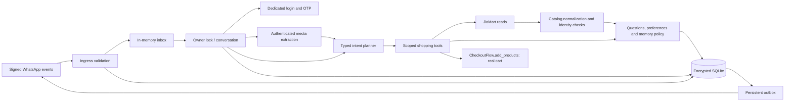
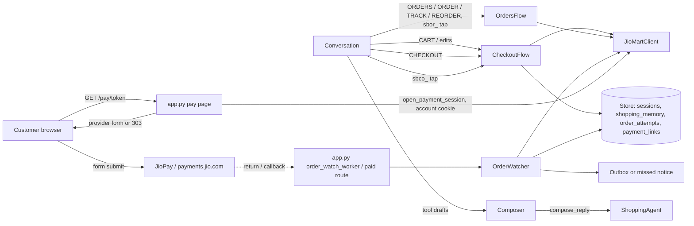
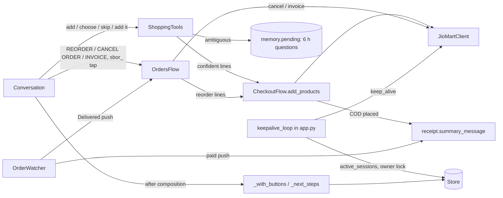

# Implemented shopping-agent interactions

Operational health includes passive outbound transport observations from the outbox worker. It starts `not_observed`, becomes `auth_rejected` after HTTP 401 and degrades the top-level status, then becomes `available` after a provider-accepted send. These values are process-local and health checks perform no network probes. Acceptance is distinct from recipient delivery receipts; a running service and tunnel alone do not prove replies work.

## System architecture

The application is a modular monolith running in one Python process.
FastAPI accepts signed Meta or temporary OpenWA events, according to configuration.
One owner lock serializes each customer's local conversation work.
An in-memory queue connects ingress to two workers.
SQLite owns encrypted account state, shopping memory and the outgoing-message queue.
There is no distributed broker, runtime agent swarm or standalone MCP server.

The model interprets language and ranks catalog candidates.
It returns Pydantic-validated action and item records.
The controller supplies identity and location from verified local state.
Tools cannot select another customer or arbitrary API URL.
Deterministic code validates product identities and applies local list changes.
Customer-facing commerce assertions are rendered from actual tool results.
Since late evening on 18 October the model may reword those results into one reply, but only under a deterministic amount/order-ID/line check (Flow 10).

The application now supports daily conversation context, retained shopping lists,
explicit preferences, bounded purchase evidence and authenticated media input.
A list is a local draft, not an upstream cart.
(19 October: the local list is retired. Tools add confident matches straight into the
real JioMart cart through `CheckoutFlow.add_products`; ambiguous products are short-lived
questions. See Flow 11.)
The JioMart adapter includes cart reads and disabled-by-default cart writes.
No planner action submits checkout, payment or orders.
Since the 18 October evening build, flag-gated `CheckoutFlow` copies the list into the
real JioMart cart and can submit an order, but only on a server-issued button tap.
Planner actions can request CHECKOUT or cart edits; they never submit an order themselves.
The remaining transactional design is in the [agent architecture](../../docs/agent-architecture.md).

The active transport is Meta.
The owner confirmed real login, search and product-card/button replies after verification.
Earlier OpenWA use and Meta verification restrictions are historical.
Business-initiated billing and stable deployment remain separate matters.
A temporary callback tunnel is not a production deployment.

## Flow 1: authenticated text shopping

1. `app.py` reads at most 256 KiB and verifies raw-body HMAC.
2. It checks WABA, phone-number ID, sender allowlist, timestamp and message ID.
3. `Store.claim` records the HMAC event key before queueing.
4. A worker obtains the owner-specific `asyncio.Lock`.
5. `Conversation.handle` handles hard account commands and sensitive input first.
6. Without an authenticated account the customer sees the connection prompt.
7. The verified account/application selects an isolated memory record.
8. `roll_session` clears short context on a new India day or four-hour idle gap.
9. Deterministic LIST/HISTORY/MEMORY/FORGET commands can bypass intent parsing.
10. Other shopping text goes to `ShoppingAgent.interpret` with bounded safe context.
11. The planner returns `Intent`, quantities and references, never an API body.
12. Search uses the existing candidate/card path.
13. Add/replace/list/edit/preference actions enter `ShoppingTools.execute`.
14. Tools search a bounded candidate set and use model rank plus deterministic veto.
15. A saved preference can resolve only a compatible unspecified request.
16. Explicit current brand/pack/formulation requests override remembered defaults.
17. Unknown or differing candidates remain choices instead of silent replacements.
18. Local line changes increment the draft version and invalidate pending choices.
19. The controller saves encrypted memory, including completed partial-list work.
20. The worker enqueues replies and completes the inbound event claim.
21. The outbox delivers separately; retrying delivery does not repeat tool execution.

## Flow 2: account linking and reconnection

1. LOGIN starts a dedicated JioMart OTP challenge.
2. A new login clears the prior active credential/location context.
3. The challenge stays in encrypted authentication state.
4. OTP text is routed directly to `verify_login`; it never enters a model call.
5. The adapter carries verification-issued cookies into `GET /session`.
6. It validates the returned account against the requested mobile.
7. An explicitly mismatched application is rejected.
8. A successful session contains the verified account and configured application.
9. Saved address reads supply an initial visible delivery area where available.
10. Shopping memory is loaded only through the newly verified account key.
11. Reconnecting the same account can resume an unfinished list.
12. Another account cannot inherit the previous account's preferences or list.
13. Authentication expiry removes local credentials without deleting shopping memory.
14. LOGOUT deliberately removes local credentials and all owner shopping memory.
15. FORGET deletes the current account's shopping memory but keeps login.
16. Neither command deletes JioMart account records or existing WhatsApp messages.

The session API can omit application metadata.
Cart validation compares authoritative account identity and rejects any explicit application mismatch.
Legacy application metadata may be backfilled only within the established consumer-app scope.
It must never infer identity from an HTTP 200 cart response, which may describe a guest cart.

## Flow 3: voice notes and product images

1. Signed Meta events provide a media ID and MIME, never a user-controlled download URL.
2. Only that minimal reference enters the process-local queue.
3. The worker first checks connected-account and OTP-challenge state.
4. Unauthenticated media is rejected before download or OpenAI use.
5. `MediaProcessor` obtains provider metadata with the Meta bearer credential.
6. It accepts only explicit HTTPS Meta attachment hosts and no redirects.
7. Signed MIME, metadata MIME and response Content-Type must agree.
8. Streaming caps bound audio to 8 MiB and images to 5 MiB.
9. Supported audio goes to Whisper `whisper-1` with its actual file format.
10. WhatsApp Ogg/Opus is handled as OGG; unsupported raw AAC/Opus is rejected.
11. Vision sends an in-memory data URL with a structured product-query schema.
12. Uncertain image extraction asks for clearer input.
13. Raw media is not written to application storage or logs.
14. Deterministic extraction filters administrative control phrases.
15. `Conversation.handle(shopping_only=True)` independently permits only search/add.
16. Model-selected logout, forget, checkout or other administrative actions are rejected.
17. The usual matching and draft path handles accepted shopping text.
18. Replies use the normal encrypted outbox.

## Flow 4: history and personalization

1. A shopping-list add can refresh history when its bounded cache is stale.
2. HISTORY requests an explicit refresh, including after FORGET suppression. (Since the evening build, HISTORY routes to the orders list in Flow 6; no chat command now forces this refresh or lifts the suppression.)
3. The adapter uses only the supplied authenticated customer session.
4. It bounds the first order page and optional detail hydration.
5. Safe path encoding prevents upstream order identifiers from altering routes.
6. Only understood delivered statuses contribute product evidence.
7. Products retain minimum identity, brand/pack, order/date and quantity provenance.
8. Unknown dates or stale purchases are ineligible for personalization.
9. Evidence is ordered by recency and capped before storage.
10. Empty responses remain unresolved, not a claim of no past purchases.
11. Optional history failures do not invalidate a working catalog session.
12. Explicit saved preferences take precedence over purchase inference.
13. Current customer instructions take precedence over both.
14. A preferred SKU must appear among newly retrieved compatible candidates.
15. If absent, tools ask the customer to choose instead of substituting silently.
16. One-off choices are not promoted to durable preferences automatically.

## Communication contracts

`app.py` owns worker lifecycle and directly calls conversation and media adapters.
`conversation.py` owns account control, memory loading and tool dispatch.
`agent.py` owns the OpenAI client and typed interpretation/ranking schemas.
`tools.py` calls the commerce/agent interfaces and deterministic memory policy, and (since 19 October) the injected `CheckoutFlow` to add products to the real cart.
`memory.py` depends only on product-matching helpers and standard-library date logic.
`catalog.py` does not know channel credentials or account state.
`jiomart.py` owns external consumer-API transport, never WhatsApp identities.
`storage.py` is the only SQLite writer.
`whatsapp.py` owns outbound Meta formatting and transport.
`checkout.py` (`CheckoutFlow`) owns real-cart sync/edit, review, confirmation, submission and pay-link records.
It calls `jiomart.py` and `Store`, and uses `catalog.normalize_products` and (since 19 October) `receipt.summary_message`; it no longer uses `memory.bump_draft`.
`orders.py` (`OrdersFlow`) owns order list/detail/track/reorder and (since 19 October) cancel and invoice. It calls `jiomart.py` and `catalog.py`, and adds reorders through the injected `CheckoutFlow` (it no longer uses `memory.py`).
`order_watch.py` (`OrderWatcher`) reads attempts via `Store`, orders via `jiomart.py`, and reuses `checkout.clear_ordered_lines`, `receipt.summary_message` and `OrdersFlow.invoice_document`.
`session_keepalive.py` reads `Store.active_sessions`, calls `JioMartClient.keep_alive` under the shared owner locks and saves with `touch=False`.
`receipt.py` depends only on Pillow and the standard library.
`conversation.py` routes commerce intents and `sbco_`/`sbor_` buttons to those flows.
`app.py` builds `CheckoutFlow` with a public-origin callable, schedules `OrderWatcher`, enqueues its messages, and starts the keep-alive loop with its owner-lock map.
There are no circular module imports.
Injected fake dependencies support isolated tests without live API calls.

### Shared schemas

- `Intent`: bounded action, item queries, quantity, line/choice references and preference category. Commerce fields are `order_number` (a position in the ORDERS list, never an order ID), `cart_item` and `remove_unavailable`. Since 19 October: `viewed` and `checkout_after`, actions `skip`, `cancel_order` and `invoice`; list actions retired.
- `ShoppingLine`: product query and integer pack count.
- `Selection`: candidate IDs separated into exact and alternative sets.
- Normalized catalog record: identity/name/brand/pack/category/listing price and image URL, plus an optional `cart` reference (item, size, seller, vertical, quantity limits).
- Normalized cart: `cart_id`, items (identifiers, size, index, name, line total, availability, quantity), price breakup, validity and read coverage.
- Order summary: order ID, created time, total, payment status/mode, status text, items and shipments (state, value, timeline, expected/delivered times).
- Shopping memory: active session, open product questions (`pending`; until 18 October a draft and current choices), cart-line product details, recent chat orders, explicit preferences and history evidence.
- Media reference: kind, signed provider media ID and MIME.
- Outbox payload: recipient plus text or a validated structured product card, quick reply, list menu, `cta_url` link button, cart card, choice card (19 October) or PDF `document` (19 October).

None of these planner schemas carries cookies, access tokens, OTPs or arbitrary customer IDs.
The tool dispatcher supplies those capabilities from trusted server state.

## Shared persistence

`sessions` holds encrypted per-owner authentication and delivery context.
`shopping_memory` holds independently retained encrypted account-scoped product/task data.
`events` stores keyed provider-event claims and processing state.
`outbox` stores encrypted replies with attempt/delivery metadata.
`order_attempts` stores one encrypted record per confirmed checkout button and its outcome.
`payment_links` stores encrypted, expiring JioPay forms indexed by token digest.
See [data model](data-model.md) for keys, lifecycle and retention.

The process owner lock protects local list edits and account transitions.
It does not coordinate replicas or the customer's own JioMart app.
Local draft versions are not a substitute for upstream cart concurrency control.
SQLite writes and external commerce calls do not form a distributed transaction.
The PRD's order-attempt/idempotency records remain unimplemented.
(Superseded in part: `order_attempts` now records each submission before checkout and blocks retries.
Upstream idempotency and cross-process coordination remain unimplemented.)

## Failure and restart behavior

Incoming bodies and media are intentionally absent from durable storage.
A restart marks processing events interrupted; customers must resend lost input.
Outgoing messages return from sending to pending on restart.
Only outbound delivery is automatically retried.
A model/commerce error produces a safe, bounded message without raw error text.
Completed local draft lines survive an error on a later line.
An unknown checkout outcome cannot arise from this build because no checkout is exposed.
Future checkout must persist an attempt and reconcile uncertainty rather than replay submission.
The evening build does exactly that: an interrupted or ambiguous submission is recorded as `unknown`.
The shielded submission task survives the 150-second handler timeout and records its own outcome.
The inbox worker then tells the customer not to tap again, and checkout is never retried automatically.
A restart during submission leaves the row `submitting`, which also blocks new orders until reconciled or cleared.

## External systems and evidence

Meta Cloud API provides signed incoming messages, media retrieval and outgoing delivery.
Real login/search/card replies are proven; new media quality remains to be evaluated live.
OpenAI Responses provides typed intent, ranking and image extraction.
Whisper provides transcription through the configured private OpenAI key.
Five synthetic live intent smoke cases passed on 18 October.
JioMart consumer APIs provide the observed auth/address/search transport.
History, cart, quantity and payment readiness must be assessed independently.
A live CART read of the real cart succeeded on 18 October; cart writes, payment and orders are unverified.
JioPay is reached only by the customer's browser through `/pay/{token}`; the bot never calls it.
The local ngrok agent API supplies the public origin when `PUBLIC_BASE_URL` is empty.
Official API documentation is mapped in [API reference](../../docs/agent-api-map.md).
No development-company credentials substitute for the customer's consumer account.

## Constraints and remaining integration work

Keep the same account/application/tenant scope across every tool call.
Treat source catalog fields, extracted image text and model output as untrusted data.
Do not infer quantity stock from `sellable` or a catalog price.
Do not infer empty history from a filtered or inaccessible API response.
Do not infer an authenticated cart from HTTP 200 alone.
Do not call a local shopping list an upstream cart.
Do not expose disabled write adapters to model actions.
(Now: model actions may request CHECKOUT/cart edits only when the server flags are on; they never carry identifiers or submit orders.)
Do not submit a purchase without a current, explicit, version-bound confirmation.
Do not retry an uncertain order create before reconciliation.
Do not replace source evidence or historical observations with implementation claims.

The next commerce gates are real sellable identity/quantity, shared-cart semantics,
authoritative quote, payment prerequisites, submission idempotency and reconciliation.
Production work also requires durable inbound jobs and process-safe locking.
Manager-voice replies, full budget/dietary enforcement, returns and refunds remain future scope.
See [webhook safety](../patterns/webhook-state-safety.md) and
[bounded adapters](../patterns/bounded-external-adapters.md) before changing these boundaries.

## Channel reliability flow

At startup, `app.py` builds a `ChannelHealthProbe` from private Meta configuration.
The probe reads token metadata with app authorization, checks app/scope/expiry,
and reads the configured phone and messaging account with the channel token. It never sends a message.
The lifecycle schedules another bounded check every five minutes and closes its client.
`/healthz` returns cached safe fields; `/readyz` uses HTTP 503 for degraded status.
Expiry within 24 hours, stale probe state, worker termination, failed delivery receipts,
and outbound transport failures all prevent a green readiness result.
This is not a proof of customer delivery; Meta receipts remain separate evidence.

On outbound authentication rejection, `Store.defer_auth` retains the already-generated
reply as encrypted `auth_wait`, with the next attempt one minute later. `next_outbound`
expires these records after 15 minutes before selecting another send. This protects
against silent immediate loss during a brief credential repair without replaying old
replies indefinitely. Commerce actions and OTP verification are never retried here.
There are no new database tables or cross-process locks.

Local deployment tooling lives under `scripts/`; it belongs to the existing runtime
module. Source edits do not automatically update a staged service installation.
See [operations](../../docs/operations-reliability.md) and project status for exact
runtime paths, callback handling and verified restart results. Host power/internet,
Meta account restrictions and durable inbound work remain separate availability limits.

### Supervised local startup and recovery

1. launchd starts the staged app under `caffeinate -i` and separately starts the tunnel wrapper. Its KeepAlive policy restarts exited processes; this is not a cloud deployment.
2. The app opens the single encrypted runtime database, starts workers and reads token/phone/account access before serving. The source checkout is not imported by this installation.
3. The wrapper spawns ngrok with request inspection disabled and discovers exactly one local port-8080 tunnel from the local metadata API. It checks local worker liveness without sending a customer message.
4. The wrapper reads the existing Meta app subscription with app authorization, preserves its fields, updates a changed callback, and verifies the returned subscription. Redirects are rejected, and credentials never appear in diagnostics.
5. The wrapper waits for its child. Child exit ends the wrapper; launchd repeats startup, including callback reconciliation. App restart does not require tunnel replacement.
6. Source and runtime configuration point to the same migrated database. Deployment must drain workers and stage code explicitly; opening another app against that database is unsupported.

The 18 October controlled app and tunnel exits recovered successfully, followed by a user-confirmed reply. These tests do not cover forced host sleep, logout, network loss, upstream outages or in-memory inbound work interrupted by a crash. See [deployment decision](../../docs/architecture/decisions/0002-local-channel-reliability.md).

### Conversational message flow

1. Signed/allowlisted ingress and duplicate checks remain unchanged. The worker invokes `Conversation.handle` with only this owner's message.
2. Quick-reply IDs resolve against encrypted owner-bound state before any model call. A Connect tap becomes a deterministic LOGIN command; it never lets the model supply an account identifier.
3. Authentication, OTP, address and sensitive-input guards run first. Eligible conversational text receives a bounded recent dialogue context with only connection status and safe task facts.
4. For a guest, the planner returns conversational guidance and supported navigation. Even an add/checkout result cannot invoke a commerce tool. A connected session continues to the existing scoped tool dispatcher.
5. `Intent.reply` supplies greeting/help prose. Tool results remain authoritative. `presentation` selects supported text/buttons, and searches use catalog image cards unless text was requested; images are never fabricated.
6. The server creates expiring quick-action IDs and sends the structured reply through the encrypted outbox. Meta transport renders header-free buttons or existing image cards. Unsupported transports and failed interactive sends use the saved text fallback.
7. An eligible exchange is sanitized and clipped into the encrypted eight-message session window. OTP/account controls are excluded; a day, idle or account boundary resets conversational context independently of the durable shopping list.

## Real cart, checkout and order flows — 18 October 2026

These flows are implemented and locally tested behind `JIOMART_CART_WRITES`/`JIOMART_CHECKOUT`; live acceptance is pending (see [status](../../docs/project-status.md)).

### Flow 5: list to real cart and review

Steps 1–6 describe the evening build and are kept as history; Flow 5′ below is current.

1. `Conversation._handle` maps CHECKOUT/“place order”/“add to cart” or a planner `checkout` intent to `CheckoutFlow.prepare` under the owner lock.
2. `prepare` returns the attempt status if a submitting/unknown attempt exists for this owner/account.
3. `_refresh_cart_refs` re-searches up to 10 older list products and accepts only an exact catalog ID with a cart reference.
4. `_wanted_lines` sums duplicate lines per (item, size) and clamps to JioMart minimum/maximum/max-in-order. Lines without a cart reference are noted rather than guessed.
5. `get_cart` re-verifies the session account, then adds missing lines, updates changed quantities and calls `select_address`.
6. `_review` re-reads the cart, renders list lines then other lines, lists blockers, fetches payment options and issues `sbco_` buttons in `state["checkout"]`.

### Flow 6: tap to order, payment and reconciliation

1. `/button:sbco_…` bypasses the planner and runs `_account_button` with the owner's session and memory.
2. `handle_button` pops the action and checks expiry, binding and list version. It re-reads the cart and compares `_snapshot`.
3. `_place` writes `begin_attempt` (`submitting`) with method, cart ID, total, lines, ordered keys and the WhatsApp recipient.
4. `_submit` runs under `asyncio.shield`. `JioMartClient.checkout` re-selects the address, re-checks cart ID/total, picks the COD or JioPay option, sends best-effort cart meta, then POSTs v2 checkout.
5. The outcome is written with `update_attempt`: `failed`, `unknown`, `placed` (COD; list lines cleared) or `awaiting_payment` (online; `save_payment_link` with a 45-minute expiry). Late evening: with an order ID, `Store.supersede_unpaid` first marks the account's older `awaiting_payment` attempts `superseded` and deletes their links.
6. `_total_warning` compares `get_order_detail` with the confirmed total.
7. ORDER STATUS (while pending) and CLEAR ORDER CHECK call `_reconcile`, which reads `list_orders`.

### Flow 7: order updates

1. `order_watch_worker` sleeps `ORDER_WATCH_INTERVAL_SECONDS`, refreshes the public origin, then calls `check_orders`. `/paid/{token}` calls `check_orders(only=attempt)` immediately.
2. `OrderWatcher.check` takes each due `awaiting_payment`/`placed` attempt from the last seven days, re-reads it under the owner lock and calls `_step`.
3. `_step` reads `get_order_detail` with the stored session and saves refreshed cookies with `touch=False`. It maps `order_stage`, decides nudge/give-up/push by `RANK`, deletes payment links when leaving `awaiting_payment`, and clears online-ordered lines when payment is confirmed.
4. A message is returned for `Store.enqueue` only if `last_inbound` is within 23.5 hours. Otherwise it is saved as `missed_notice`, which `Conversation.handle` prefixes to the next reply.
5. Per-order exceptions reschedule that order after 10 minutes without affecting others.

### Flow 8: orders, tracking and reorder

1. ORDERS/HISTORY call `OrdersFlow.recent`, which uses `list_orders` (first My Orders page) and stores `orders_view` and `order_actions`.
2. ORDER n, TRACK n and REORDER n resolve n against `orders_view`, else the newest orders, then call `get_order_detail` and, for TRACK, `track_shipment`.
3. REORDER re-searches each item and appends only exact, still-sellable catalog IDs to the list with `source: reorder`, bumping the list version.

## Late evening 18 October — basket, payment session and composition flows

Live evidence for these flows (cart edits, one paid online order, the payment push, composed replies) is in [status](../../docs/project-status.md).

### Flow 5′: building and reviewing the basket

1. `Conversation._handle` routes add/replace/choose to `ShoppingTools.execute`, recording each draft line's `(id(line), product id)` beforehand. Typed “choose/option/pick N” and tapped `sbch_` rows become a deterministic `choose` intent.
2. With cart writes on, `_move_to_cart` passes the lines created or resolved by this request to `CheckoutFlow.sync_list(only=…)`. It re-reads the cart, adds only products not already there (larger quantity for duplicates), removes moved lines from the list and bumps its version.
3. ADD MY LIST calls `prepare(add_list=True)`, which runs `sync_list` over every chosen line before reviewing. CLEAR LIST empties the draft. EMPTY CART calls `CheckoutFlow.empty_cart` (one `remove_item` request).
4. CHECKOUT calls `prepare` without adding: `select_address` (its 307 to `/ext/jmshipmentfee/…` is followed on `www.jiomart.com`), then `_review` → picture `cart_card` or text + quick reply.

### Flow 9: server-side payment session

1. The customer opens `/pay/{token}`. `app.py` loads the `payment_links` row and requires the attempt to be `awaiting_payment`.
2. If the stored fields are JioOnePay merchant IDs (no `base64_html`), it takes the owner lock, loads the session and calls `JioMartClient.open_payment_session`. It saves the session with `touch=False`.
3. The adapter POSTs the fields with the account cookie, follows JioMart-host redirects (at most six), and returns the first non-JioMart redirect, an HTML form or a JSON payment URL.
4. The page returns a 303 redirect or an auto-submitting provider form; the browser completes payment with the provider. `/paid` and the watcher confirm from JioMart's order record.

### Flow 10: reply composition and outbound rendering

1. `inbox_worker` fires `WhatsApp.acknowledge(message_id)` in the background (read receipt + typing indicator), then runs the conversation under the owner lock.
2. `Conversation.handle` runs `_dispatch`. If `_composable`, `Composer.apply` calls `ShoppingAgent.compose_reply` and keeps the result only when `faithful` passes. Missed order notices are prefixed afterwards.
3. The outbox stores structured messages. For `cart_card`, `WhatsApp.send` fetches CDN images (`cart_image.fetch_images`), draws the collage, uploads it to `/{phone_id}/media` and sends `image_buttons`. Any non-auth failure swaps in the text fallback (`Store.fallback_to_text`).

## 19 October 2026 — single basket, next-step buttons, keep-alive and order documents

Implemented and locally tested (307 tests); not deployed and not live-verified. See [status](../../docs/project-status.md) and [ADR 6](../../docs/architecture/decisions/0006-jiomart-cart-is-the-only-basket.md). These flows supersede Flow 5′ steps 2–3 (list moves, ADD MY LIST, CLEAR LIST) and the button lifetimes above.

### Flow 11: adding to the cart

1. `Conversation._handle` maps typed `choose/option/pick N`, `skip`, “clear list”/“skip all”, “keep shopping”, “add it/this” (`Intent(add, viewed=True)`) and the LIST/CART commands deterministically; other text goes to `ShoppingAgent.interpret` with `ShoppingTools.context` (`pending`, `choices`, `viewed`, preferences, previous queries) plus `cart` from `CheckoutFlow.view_context`.
2. `ShoppingTools.execute` handles `add`/`choose`/`skip`/`remember`/`memory`/`forget`/`new_session`. `_add` searches and ranks each item (catalog veto unchanged), drops any older `pending`, stores new questions and calls `_receipt` → `CheckoutFlow.add_products` once for confident lines.
3. `add_products` re-reads the cart (after authoritative session verification inside the adapter), adds only missing products in batches of 20, records `cart_products` and `just_added`, and returns added/already/notes/error.
4. `next_choice` asks the first open question (`choice_card` or `list`). With `checkout_after` and no open question, `CheckoutFlow.prepare` appends the review.
5. `_commerce_action` routes `cart_remove`/`cart_quantity` (including “one more milk” resolved by the planner against `cart` lines) to `edit_cart`, `reorder` to `OrdersFlow.reorder` → `add_products`, `cancel_order`/`invoice` to `OrdersFlow`.

### Flow 12: reply finishing

`Conversation.handle` → `_dispatch` → `Composer.apply` (if composable) → voice transcript prefix (for `voice=True`) → `_with_buttons` (adds `sbqa_` shortcuts chosen by `_next_steps`, saved in `button_actions`) → missed order notice prefix. The inbox worker then chunks and enqueues the replies; `WhatsApp.send` renders `choice_card` (uploaded numbered collage, or the stored `list` on failure) and `document` (uploaded PDF) at send time.

### Flow 13: session keep-alive

1. `create_app` starts `keepalive_loop(store, commerce, locks, interval=SESSION_KEEPALIVE_INTERVAL_SECONDS, active_within=SESSION_TTL_SECONDS)` alongside the inbox/outbox workers, independent of commerce flags.
2. Each cycle, `run_keepalive_once` takes `Store.active_sessions`, acquires the owner's lock (the same map the inbox worker uses), re-reads the state and calls `JioMartClient.keep_alive(session)`.
3. `keep_alive` refreshes when the access JWT is unreadable or expires within 15 minutes, using `_refresh_session` (documented body, then cookie-only on HTTP 400), and writes cookies back into the session dict. The state is saved with `touch=False`.
4. Independently, every adapter request refreshes first when the JWT has 5 minutes or less left, and still refreshes once after a 401/403 when it has not already refreshed.

### Flow 14: cancellation, invoices and summaries

1. CANCEL ORDER n → `OrdersFlow.cancel` (needs `JioMartClient.order_cancel_enabled` and a `can_cancel: true` shipment) → confirmation card with `cancel_confirm`/`keep` `sbor_` buttons.
2. `cancel_confirm` → `_confirm_cancel` re-reads `get_order_detail`, then per shipment `cancellation_reasons` → `cancel_shipment`. `rejected` stops with “nothing changed”; `unknown` stops with “check My Orders” and is never retried.
3. INVOICE n → `OrdersFlow.invoice` → `invoice_document` → `JioMartClient.invoice_pdf` (lookup, allowlisted HTTPS download without redirects, ≤5 MB, PDF) → outbox `document`.
4. `CheckoutFlow._submit` appends `receipt.summary_message` to the cash-on-delivery placement reply; `OrderWatcher._step` appends it to the online “Payment received” push and appends `invoice_document` to the Delivered push when the shipment is not marked without an invoice.

### Flow 15: substitutes (19 October, later)

Implemented and locally tested; not deployed.

1. Add path: `ShoppingTools._add` → no sellable exact match → `_unavailable` (what can't be had, and how to say it) → `_substitutes` (gate `catalog.product_is_substitute`; at most one extra `JioMartClient.search` for a bought-before product) → `memory["pending"]` item with `substitute.note` → `next_choice`.
2. Checkout path: `CheckoutFlow._review` (blocked, unavailable lines, `substitutes` set) → `sbco_` `find_substitutes` → `CheckoutFlow.handle_button` → `ShoppingTools.cart_substitutes` (wired by `Conversation.__init__`) → `CheckoutFlow.unavailable_lines` → one `search` per line (≤3) → `_substitutes` → pending items with `substitute.replaces`.
3. Tap: `sbch_` → `choose n` → `ShoppingTools._choose` → `CheckoutFlow.add_products`; then, for `replaces`, `CheckoutFlow.remove_line` → `update_cart(remove_item)` for that one line.

