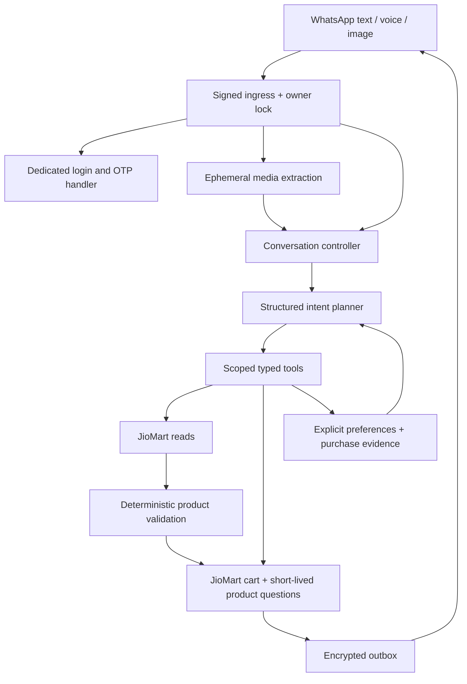
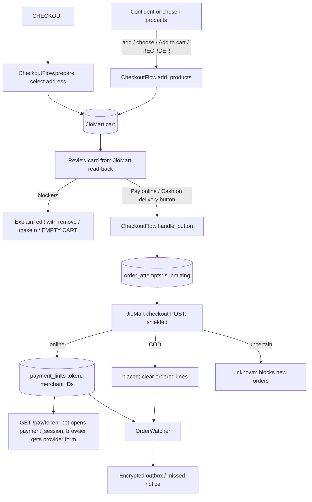

# Shopping agent architecture and implementation

18 October 2026. This document describes the current build and the remaining commerce gates. The [technical PRD](technical-prd.md) remains the product baseline; the [API map](agent-api-map.md) links documented contracts. Real purchase completion remains an acceptance goal, not an implemented claim.

Evening update, 18 October 2026: real JioMart cart sync, customer-confirmed checkout, JioPay hosted payment links and order-update pushes are now implemented behind server flags and locally tested. Live acceptance of a cart write, payment and order is still pending; see [status](project-status.md).

Late-evening update, 18 October 2026: the first live order was created from chat, paid by UPI and confirmed by a watcher push (see [status](project-status.md)). Since the evening build the design changed in five ways. The JioMart cart is the only basket. The bot opens JioMart's payment session server-side. Replies are AI-written over tool drafts under a fact check. Product choices are tap menus. The cart is shown as a picture card. Sections below are updated in place; statements marked "earlier" are history.

19 October 2026 update (implemented and locally tested; not deployed or verified on WhatsApp): the local shopping list is retired and the JioMart cart is the only basket ([ADR 6](architecture/decisions/0006-jiomart-cart-is-the-only-basket.md)). Every reply ends with context-aware buttons, product choices can be numbered pictures, voice notes go through the normal text path, JioMart sessions are renewed before they expire, and orders gain a flag-gated cancel, invoice PDFs and an order-summary PDF. See the section at the end and [status](project-status.md).

## Experience

The agent acts like a helpful store assistant: resolve clear items, handle a multi-item request, and ask about one consequential choice at a time. A customer can say “buy dahi,” “choose 2,” “skip,” “one more milk,” “remember cart line 1 for curd,” or “show my cart.” (Earlier builds used list phrasing such as “make line 1 two” and “show my list”.) The renderer names the exact product and quantity chosen and explains whether the choice came from an explicit saved preference or purchase history.

Earlier build: a local shopping list was distinct from a JioMart cart, and the bot said “on your shopping list.” It cannot claim stock, reserved inventory, fees, a payment link, or order success from catalog results. Read-only product size/seller adapters are also implemented for contract validation. Cart add/update adapter methods are disabled by default. Only a server-issued payment button, never planner prose or a typed “yes”, can submit an order, and only when `JIOMART_CHECKOUT` is also on.

Late-evening 18 October build with `JIOMART_CART_WRITES` on: **the JioMart cart is the basket.** When “buy dahi” or “choose 2” resolves a product, that line goes straight into the account's real JioMart cart and leaves the list. Only lines created or resolved by the current request move. The local list keeps lines still waiting for a product choice, plus older chosen lines that were never moved (for example, saved before cart writes were on); they stay there until ADD MY LIST or CLEAR LIST. CHECKOUT reviews the cart exactly as it is and never adds list items; ADD MY LIST explicitly moves every chosen list line. A product already in the cart keeps its cart quantity, and the same product requested twice becomes one line at the larger quantity, never the sum. The review shows JioMart's own prices and fees.

Current build (19 October): **there is no local list.** “buy dahi”, a tapped Add to cart, “add it” for the product just shown, a numbered choice and REORDER all put products straight into the cart. A product that needs a choice becomes a short-lived question (6 hours, asked one at a time, as numbered pictures when catalog images exist); any newer add request replaces open questions, so an older request never resurfaces. LIST and “show my list” show the cart, and “one more milk” edits the matching cart line. With cart writes off nothing can be added and the bot says so.

For unspecified curd, a saved exact product or eligible delivered purchase can resolve the choice. A specific current brand or pack always wins. If the remembered SKU is absent, the bot offers choices; it does not silently replace it. A new choice is one-off until the customer explicitly asks the bot to remember it.

## Components

| Component | Implemented responsibility | Boundary |
|---|---|---|
| Meta ingress (`app.py`) | Verify signature/account/sender, freshness, event deduplication; enqueue text/button/media reference. Also serves `/pay/{token}` and `/paid/{token}` and runs the order-watch worker when checkout is enabled | Incoming queue remains process-local; pay pages trust only stored tokens, never request headers |
| Account controller (`conversation.py`) | Handle LOGIN/OTP/address/logout before AI; bind account to sender; route CART (also LIST)/CHECKOUT/EMPTY CART/ORDERS/ORDER/TRACK/REORDER/CANCEL ORDER/INVOICE/ORDER STATUS/CLEAR ORDER CHECK, “choose/option/pick N”, SKIP, “clear list”/“skip all”, “add it” and `sbco_`/`sbor_`/`sbch_`/`sbpc_`/`sbqa_` taps; record last inbound time and show missed order notices; hand composable replies to the composer; end every reply with context-aware buttons (`_with_buttons`); prefix voice replies with the transcript. (Earlier: ADD MY LIST/CLEAR LIST and moving list lines into the cart) | OTP and credentials excluded from prompts; login/OTP/address replies are never recomposed |
| Reply composer (`composer.py`) | Ask the model (`ShoppingAgent.compose_reply`) to merge tool drafts into one natural reply and reword an interactive lead-in; `faithful` checks every ₹ amount, order ID and “N × Product” line survived and that no amount was added | On any failure or mismatch the verified draft is sent; buttons, links and IDs are never model-written |
| Cart picture (`cart_image.py`) | Fetch up to nine JioMart CDN thumbnails (HTTPS `cdn1.jiomartjcp.com` only, 6-second timeout, no redirects, 2 MB each) and draw a white JPEG grid with ×N badges | Built in memory for one upload; nothing about the customer is drawn or stored |
| Media adapter (`media.py`) | Fetch authenticated Meta media; Whisper voice transcription; structured vision product extraction | Bytes remain in memory, limited size/hosts/types; no administrative actions through media |
| Planner (`agent.py`) | Responses structured `Intent` and `ShoppingLine`; language/alias interpretation, quantity, action and reference extraction, including `add`, `choose`, `skip`, `checkout`, `cart`, `cart_remove`, `cart_quantity`, `empty_cart`, `orders`, `order_status`, `track`, `reorder`, `cancel_order` and `invoice`, plus the `viewed` and `checkout_after` flags. Context includes open questions, the product just shown and the last shown cart lines (names and quantities) | Chooses a typed action; cannot supply URLs, account credentials, prices, order IDs or arbitrary API bodies. Its instructions reflect the server's cart-write/checkout flags, which model input cannot change |
| Tool controller (`tools.py`) | Search and rank each requested item, add confident matches to the real cart through `CheckoutFlow.add_products`, keep ambiguous ones as short-lived questions (`next_choice` renders a picture choice or tap menu), skip, remember a cart line as a preference, history retrieval, preference inspection/forget. (Earlier: a local draft list with add/edit/remove/choice) | Backend selects account/location and validates every reference |
| Matching (`catalog.py`) | Normalize catalog, reject incompatible exact matches and invented IDs | Listing sellability does not prove quantity stock |
| Memory policy (`memory.py`) | Daily/idle session rotation (which also drops expired questions and any list left by older builds), scoped preferences, recent-history selection, the 6-hour question lifetime | Bounded structured state; no growing transcript |
| Commerce adapter (`jiomart.py`) | Existing auth/address/search plus history/cart read; flag-gated cart add/update/remove, saved-address selection, payment options and checkout; order list/detail/shipment tracking reads with a `www.jiomart.com/api` fallback; one JioMart-host 307/308 redirect per account request; proactive token refresh when under 5 minutes remain, else one refresh and retry on 401/403 (documented body, then cookie-only on HTTP 400); `keep_alive`; server-side `open_payment_session`; flag-gated `cancellation_reasons`/`cancel_shipment`; `invoice_pdf` | Cart writes, checkout and payment were exercised live on 18 October; the refresh changes, cancellation and invoices are unverified. Request shapes follow JioMart's public web code where noted in the [API map](agent-api-map.md) |
| Checkout flow (`checkout.py`) | CART view/edit and EMPTY CART, adding chosen products to the cart (`add_products`; earlier `sync_list` moved list lines), CHECKOUT review of the cart as it is, picture cart cards, payment-choice buttons, single-use confirmation, persisted order attempts, shielded submission, superseding older unpaid attempts, reconciliation and payment-link creation | Places an order only from a server-issued button; flags, the ₹ cap and review blockers apply; a cash-on-delivery placement also sends an order-summary PDF |
| Orders flow (`orders.py`) | ORDERS/HISTORY list, ORDER n details card, TRACK n, REORDER n, CANCEL ORDER n (with a confirmation button), INVOICE n and order buttons | Reorder adds to the cart, never an order (earlier it filled the list). Cancel needs `JIOMART_ORDER_CANCEL`; an unknown cancel outcome is never retried |
| Order watcher (`order_watch.py`) | Polls orders placed from chat; one push per stage, payment nudge/give-up, link revocation, recording the order; attaches the order summary to the online payment push and JioMart's invoice to the Delivered push when available | Sends only within WhatsApp's customer-service window; otherwise shows the update on the next inbound message |
| Persistence (`storage.py`) | Encrypt authentication state, shopping memory, outbox (including base64 PDF documents), order attempts and payment links; HMAC indexed ownership; `active_sessions` for the keep-alive | Single process SQLite, not a scalable durable worker system |
| Session keep-alive (`session_keepalive.py`) | Every `SESSION_KEEPALIVE_INTERVAL_SECONDS` (600), renew each stored session used within the session lifetime, under the owner lock, saving with `touch=False` | Never extends the local session lifetime; logs categories only; unverified live |
| Order summary (`receipt.py`) | Build a one-page A4 PDF in memory (Pillow) from the confirmed order record: lines, line totals, charge breakup, total, payment method | Labelled “not a tax invoice”; nothing written to disk |
| Delivery (`whatsapp.py`) | Text/catalog cards, quick replies, interactive list menus, numbered picture choices, `cta_url` link buttons, the uploaded cart picture with an image header, uploaded PDF documents, best-effort read receipt plus typing indicator, and delivery state | Delivery success is separate from commerce success; a failed rich message falls back to its saved text |



The decision is recorded in [ADR 1](architecture/decisions/0001-shopping-agent-memory.md). One controlled agent is sufficient. A free-running multi-agent system would add latency and make transaction ownership harder to reason about. The planner handles language; deterministic code owns identity, tool execution, state, and customer-facing commerce claims. The current flow makes one intent call and up to five bounded search/rank operations, with a bounded history refresh. It does not recursively call tools without a limit.

## Tools rather than a separate MCP server

MCP is a transport/protocol for exposing tools, not a prerequisite for an agent. The initial app uses typed in-process tools: no extra network service, second authentication system, or remote arbitrary-tool execution is needed. `Intent`/`ShoppingLine` are the validated planner contract; `ShoppingTools.execute` is the dispatcher. Search and account operations use the existing controller.

Actions in the 18 October builds: search, add/replace draft lines, review, remove, set quantity, choose a current option, history, remember, memory inspection, forget, new session, login, logout and pincode selection. Checkout was explicitly unavailable in the earlier build. The evening build routes `checkout`, `cart`, `cart_remove`, `cart_quantity`, `orders`/`history`, `order_status`, `track` and `reorder` to the checkout and orders flows instead of `ShoppingTools`. If cart writes are off, CART shows the local list and CHECKOUT explains that the cart is not connected; only a server-issued button can place an order. The late-evening build adds `add_list`, `clear_list` and `empty_cart` actions (ADD MY LIST, CLEAR LIST, EMPTY CART). With cart writes on, `add`/`replace`/`choose` still run in `ShoppingTools`, then the controller moves only the lines that request created or resolved into the real cart. 19 October: `add_list`, `clear_list`, `replace`, `review`, `remove` and `set_quantity` are retired with the list; `add`, `choose` and `skip` run in `ShoppingTools` and write to the cart directly, and `cancel_order` and `invoice` go to the orders flow. If another client later needs these tools, wrap these same scoped services in MCP; identity must come from the authenticated server session rather than a model-provided customer ID.

The future commerce tools are `get_sellable_details`, `check_quantity`, `read_cart`, `apply_cart_edit`, `quote_cart`, `submit_confirmed_order`, and `reconcile_order`. Read-cart and disabled adapter writes are preparation; no model tool presently grants purchase authority. In the evening build, the read/edit/quote/submit/reconcile steps exist as `CheckoutFlow` methods called by the controller, not as model tools. The quote is JioMart's own cart read-back. The planner can request an action, but submission still requires the customer's tap on a single-use button bound to the reviewed basket.

## Memory and context over months or years

Keep three independent kinds of state:

1. **Account session:** encrypted credentials and selected address. Since 19 October it expires locally 30 days after the customer's last message (earlier: 24 hours), and a background keep-alive renews JioMart's roughly one-hour access token while it lasts. Expiry requires reconnecting; it does not erase shopping memory.
2. **Task memory:** open product questions (at most three options per item, 6 hours, replaced by any newer add request), product details for up to 40 cart lines, the last five chat-placed orders and up to five previous product queries. Earlier builds kept a 30-line versioned shopping list instead. No raw dialogue history is accumulated.
3. **Long-term product memory:** at most 50 explicit category preferences and at most 50 normalized purchase evidence items. Explicit preferences expire after 180 days; unused memory records are removed after 180 days. Imported history has a short refresh/relevance policy and is never a permanent instruction.

Memory is keyed by the existing channel/tenant owner digest plus application/verified-account digest. Reconnecting to the same account retrieves its preferences and open questions (earlier: its list). Linking another account cannot inherit them. LOGOUT removes the owner's saved local access and shopping memory; FORGET removes preferences, imported history context and every other shopping-memory entry (earlier: including the draft list) while retaining login; the JioMart cart is unchanged. FORGET suppresses automatic history re-import; an explicit HISTORY request can retrieve it again. Provider delivery records retain their existing separate seven-day retention.

A session rotates at the Asia/Kolkata calendar-day boundary or after four hours of inactivity. The first new message resets previous queries, but retains explicit preferences; open product questions survive only until their own 6-hour expiry. (Earlier: it reset pending choices and kept the shopping list.) This combines the user's daily-session idea with continuity of unfinished work. A new-day reset must never cancel an upstream order or payment. Those transactional records now have their own lifecycle in the `order_attempts` and `payment_links` tables (see below), independent of session rotation and LOGOUT.

The planner gets bounded product/task fields and up to eight sanitized recent user/assistant messages of at most 480 characters each. It never receives encrypted credentials, full addresses, raw orders, media bytes, or an unlimited historical transcript. The amount of context remains bounded regardless of account age. A vector database and LLM-generated running summary are unnecessary for these structured grocery facts. Semantic retrieval can be added later if real usage demonstrates a need.

The short dialogue window now lives in encrypted session state, including a guest
scope before login. Account linking clears it; a new account cannot read the old
account's conversation. Daily/idle rotation, NEW SESSION, FORGET and LOGOUT clear it
without changing the independent list/preference lifecycle except where those commands
explicitly remove shopping memory. Login/OTP/address controls are excluded, common
contact/credential patterns are redacted, and no complete transcript is kept. Greetings
and help use AI-authored replies, with server-controlled quick actions and catalog cards.
See [decision](architecture/decisions/0003-bounded-conversation-and-presentation.md).

Preference precedence: current explicit request → current task choices → explicit saved preference → recent delivered purchase evidence → disclosed one-pack default when only one exact candidate exists. History empty/error is not a fact about whether the customer has purchased before. Unsupported shapes or unknown status/date never become remembered purchases.

## Voice and images

The requested OpenAI speech service is **Whisper**, using `whisper-1`. Signed Meta media IDs are resolved to authenticated allowlisted HTTPS download URLs. Audio and images have separate byte limits. There are no arbitrary user URL fetches or persisted recordings. The worker rejects media during OTP entry or without a connected account. Outside login, media content necessarily reaches the selected OpenAI extraction service before its contents can be checked; customers should send only shopping material.

Vision extracts bounded product queries from a photo or list; ambiguous extraction asks for clearer input. Media-derived requests are restricted to shopping search/add actions even if the model returns an account or settings action. Text remains available for all controls. Partial-image confidence handling and real Hindi/Hinglish/noisy audio evaluation remain acceptance work; passing fake-provider tests does not prove media quality on real WhatsApp notes.

## Implemented checkout, payment and order updates — 18 October 2026

This section replaces the earlier "checkout state machine to implement after contract validation". The design below is implemented and locally tested. Live acceptance is tracked in [project status](project-status.md); at the time of writing no cart write, payment or order placed by the bot had been verified on the real account. The decision is recorded in [ADR 4](architecture/decisions/0004-real-cart-checkout-and-order-updates.md).

### Gates

`JIOMART_CART_WRITES` enables real cart writes, address selection and CART edits. `JIOMART_CHECKOUT` additionally enables payment options, order submission and the order watcher; it has no effect without cart writes. The `/pay` and `/paid` routes always exist but serve only stored, unexpired links. Both default to false and are enforced in both `JioMartClient` and `CheckoutFlow`. `ShoppingAgent` receives the same flags only to describe capabilities, and model input cannot change them. `CHECKOUT_MAX_TOTAL` (optional; default 0 = no limit since 19 October, earlier ₹1,500) caps a single confirmed order when set.

### Flow

Earlier flow (evening build), kept for history: CHECKOUT refreshed legacy cart IDs, added/updated JioMart cart lines from the whole list, then selected the saved address. Current flow:

```text
add / choose / Add to cart tap / “add it” / REORDER (cart writes on) → CheckoutFlow.add_products → JioMart cart
  (ambiguous products become short-lived questions; until 18 October: list lines, moved by add/choose or ADD MY LIST)
CHECKOUT (never adds) → select saved address
  → REVIEW: JioMart lines, fee breakup, total; blockers or payment buttons (single use; 30 minutes since 19 October, 10 before)
  → tap: re-read cart; compare snapshot, account/address binding, expiry (the list version was dropped on 19 October)
  → order_attempts "submitting" (one per button)
  → POST checkout
      → placed (cash on delivery) ─┐
      → awaiting_payment (online) ─┤→ watcher → placed (paid) → delivered | cancelled
      │                            └→ failed (payment failed) | unpaid (3 h) | superseded (a newer chat order)
      → failed (definite rejection; nothing created)
      → unknown → ORDER STATUS reconciliation → placed | awaiting_payment
                → CLEAR ORDER CHECK (only if reconciliation finds nothing) → dismissed
```

Placed and awaiting-payment attempts are watched for seven days after creation (`watch_ended` marks one that crosses that limit while being processed). Attempt rows are pruned after 30 days.



### Earlier prerequisites and their current status

| Earlier prerequisite | Implemented behavior | Remaining gap |
|---|---|---|
| Resolve sellable product/size/seller identifiers and quantity rules; recheck for the destination | Catalog normalization keeps the listing's own `item_id`, single size, `seller_id`, vertical code and minimum/maximum/max-in-order limits. Quantities are clamped to those limits and the change is disclosed. Availability and validity are read back from the cart for the selected address. List lines saved before cart support are re-found by exact catalog ID only (at most 10 per CHECKOUT) | No separate quantity-stock call; JioMart assigns the store; live behavior unverified |
| Read the existing cart; determine sharing with the JioMart app; preserve unrelated items; detect concurrent changes | Earlier: existing lines were shown under “Already in your JioMart cart” with an optional “Remove other items” button. That button deleted customers' own items live and is retired. Now the whole cart is the customer's basket and is reviewed as it is, with lines added by this request marked “(just added)”. The snapshot comparison at tap time detects changes to lines, prices, availability, total or address | Live 18 October: CART, adds, removals, quantity changes and EMPTY CART worked on the account's own cart |
| Apply exact changes once and read back | Products are added once, in batches of at most 20 (until 18 October they moved from the list and then left it). A product already in the cart is never re-added or re-quantified by a move (“Already in your cart, left as it is”), so a removed item cannot come back. Duplicates use the larger quantity. The cart is re-read for the reply | JioMart exposes no cart version; the snapshot hash stands in for one |
| Complete quote, fees and prerequisites; integer or decimal amounts | The saved address is selected, then JioMart's breakup is shown (items, discount, coupon, delivery, COD fee, convenience fee, total). When JioMart charges fees under names the bot does not map, a “Delivery & other charges” line shows the remainder so the lines add up to the total. Payment options are requested for the exact total in paise. Checkout re-selects the address and re-checks cart ID and total before the POST | Quote expiry, delivery slots/speed and coupons are not handled |
| Bind confirmation to account, cart version, line/price snapshot, delivery context and expiry | An opaque `sbco_` button is bound to account reference, address ID and pincode and expires in 30 minutes (10 before 19 October). Until 18 October it also carried the local list version. It carries a SHA-256 snapshot of cart ID, line keys, quantities, line totals, availability, total, validity and address ID. Any change invalidates it | The inbound message ID is not recorded with the attempt |
| Persist a unique attempt; idempotency or reliable lookup; never blindly retry | `begin_attempt` inserts an `order_attempts` row keyed by an HMAC of the button ID before the POST (`INSERT OR IGNORE`, so a button submits once). The submission runs in a shielded task, so the 150-second handler timeout cannot cancel it. Submitting/unknown attempts block new orders. Reconciliation accepts exactly one JioMart order with the same total (±₹0.50) created no earlier than two minutes before the attempt | No upstream idempotency key; reconciliation is a heuristic; single process only |
| Payment return is untrusted; no separate order-create call | `/paid/{token}` only triggers a status check. Payment is confirmed only by JioMart's order record (payment status or post-payment shipment values). The checkout POST itself creates the order: directly for cash on delivery, or awaiting payment for online | Live 18 October: one online order was paid by UPI and confirmed from JioMart's order record. `callback_url` honouring is unverified |

### Outcome classification

Before the checkout POST, `JioMartClient.checkout` re-selects the address, re-reads the cart and fetches payment options. Any failure there is a definite rejection (`rejected`, or `changed` when the cart ID or total moved). At the POST, these are recorded as `failed` with nothing placed: `auth_expired`, `rejected` (including HTTP 400 and `success:false` without an order number), `changed`, and other 400/404/409/422 responses. These are recorded as `unknown`: transport errors, 5xx responses, an accepted reply without an order number, a `success:false` reply that carries an order number, and cancellation mid-submit. After a successful POST the bot reads the order detail. If the total differs from the confirmed total by ₹0.50 or more, it warns the customer and logs `order_total_mismatch`.

### Online payment link

Earlier design (evening build): the bot kept JioMart's `data.base64_html` form and the vetted payment-option `api_link`, and `/pay` auto-submitted that form from the customer's browser. Live testing showed this account's online option is JIOPP via the JioOnePay aggregator. Its checkout response carries `merchant_order_id` and `merchant_transaction_id`, and the payment link (`payment_session` on `www.jiomart.com`) requires the account's JioMart sign-in. A browser opened from WhatsApp has none, so opening it directly from the browser failed with “Invalid session” or HTTP 405 (method not allowed).

Current design: `JioMartClient.checkout` returns every safe scalar field of the checkout `data` (at most 40, names `[A-Za-z0-9_.-]`, values up to 300,000 characters) with the vetted `api_link`. The bot stores them in `payment_links`; the row is indexed by an HMAC of a random URL token, encrypted, and expires after 45 minutes. WhatsApp receives a `cta_url` “Pay ₹X” button, with a text fallback containing the link. `GET /pay/{token}` works only while the attempt is `awaiting_payment` (otherwise 404). If the stored fields include `base64_html`, it keeps the earlier browser auto-post. Otherwise, under the owner's lock, the bot calls `open_payment_session` with the account's own cookie. It POSTs the fields to `api_link` and follows at most six redirects while they stay on `jiomart.com`/`jiomartjcp.com` hosts (301/302/303 switch to GET). It stops at the first hop that leaves JioMart and returns that URL; a 200 HTML page yields its first form, and a 200 JSON reply yields a payment URL. The browser then receives a 303 redirect or a page that auto-submits the provider form; failures show “JioMart didn’t open a payment page; nothing was charged”, and an expired sign-in asks for LOGIN. Live, the chain was `www.jiomart.com` → `store1.jiomartjcp.com` (HTML form) → `payments.jio.com`. Refreshed cookies are saved with `touch=False`.

JioMart opens a payment session only once, and every Pay online tap creates a new JioMart order. When a new chat order is created, older `awaiting_payment` attempts of the same account become `superseded` and lose their links. ORDER STATUS re-sends the stored link while an order awaits payment; whether a second visit can reopen a session is unverified. The callback URL sent to JioMart is `{public origin}/paid/{token}`. The public origin is `PUBLIC_BASE_URL`, or the HTTPS ngrok tunnel serving port 8080 found through the local agent API and refreshed at most once a minute. Online payment is offered only when `JIOMART_ONLINE_PAYMENT` is true, JioMart offers a JIOPP/JIOPPLINK option with a vetted link, and such an origin exists.

### Order updates

`OrderWatcher.check` runs every `ORDER_WATCH_INTERVAL_SECONDS` (default 20) when checkout is enabled. It also runs immediately for one attempt when `/paid` is visited. It reads `awaiting_payment`/`placed` attempts from the last seven days under the owner's lock. Each customer-visible stage is pushed once, in increasing rank: payment confirmed (online only; cash-on-delivery placement was already confirmed in chat), shipped, out for delivery, delivered (items, total, payment mode) and cancelled. An unpaid online order gets one nudge after 20 minutes and a give-up message after 3 hours (`unpaid`). If JioMart will not return an unpaid online order at all, the watcher retries every five minutes and, after 3 hours, marks it `unpaid` and deletes its links without a message. Leaving `awaiting_payment` deletes the order's payment links; an online order that becomes paid also clears its ordered list lines. Live 18 October: the watcher saw a paid online order as paid/confirmed and pushed “✅ Payment received” within about 30 seconds. Session cookies refreshed by these reads are saved with `touch=False`, so a background poll never extends the local session lifetime (24 hours then, 30 days since 19 October). Pushes require an inbound message within the last 23.5 hours. Otherwise the text is stored as `missed_notice` on the attempt and prefixed to the reply to the customer's next message.

### Orders, tracking and reorder

ORDERS and HISTORY list up to five recent orders from the first My Orders page. Each shows date, total, item count and status, with Track latest / Reorder latest / Latest details buttons (`sbor_`, single use, account-bound; 24 hours since 19 October, 15 minutes before). ORDER n, TRACK n and REORDER n resolve n against that list for 6 hours (30 minutes before 19 October), otherwise against the newest orders. TRACK shows up to four recent timeline steps and, for undelivered shipments, courier/AWB from the shipment-tracking read. REORDER adds only items whose exact catalog ID is still listed as sellable (at most 12 per order). Earlier builds put them on the shopping list; since 19 October they go straight into the JioMart cart like any other add. It never places an order. Earlier, ORDER STATUS showed the checkout attempt only while one was submitting/unknown. Now it also answers from the attempt while one awaits payment, re-sending a live payment link. Otherwise it shows JioMart's details for the latest order. Order list and detail reads fall back to the `www.jiomart.com/api` gateway when the API host returns an empty list or HTTP 404.

### Remaining gaps

Live acceptance of the remaining steps: cash on delivery, shipment-stage pushes, tracking, reorder and reconciliation. Also open: refunds from chat, and live proof that the flag-gated cancellation (19 October) works on JioMart; delivery slot/speed and coupons; older orders held in the legacy UL OMS history; upstream idempotency; business-initiated (template) messages outside the WhatsApp window; and durable inbound jobs and cross-process locking. JioMart access tokens appear to last about one hour; the corrected refresh call (and, since 19 October, proactive refresh and the background keep-alive) is not yet verified live. A stable public HTTPS origin is also needed: the free ngrok URL changes on tunnel restart and shows a browser warning page before `/pay`. Serviceability, T9G8 mapping and supported access/version remain external validation dependencies. Same-account visibility of a chat-placed order was observed live for one order.

## Verification and deployment

Tests cover typed intent, memory isolation/encryption, daily rotation, explicit preference precedence, absence of silent substitution, stale choice rejection, draft editing, authenticated media processing, and existing login/search behavior. Provider contract tests use synthetic data; no customer orders are copied into fixtures. The evening build adds `test_checkout.py`, `test_checkout_conversation.py`, `test_orders.py` and `test_order_watch.py`, plus checkout/cart-add request-shape cases in `test_commerce_tools.py`. They cover cart sync, blockers, single-use and stale buttons, outcome classification, pending blocks, pay links, pay/return pages, origin discovery, watcher pushes, the messaging window and order commands; 231 tests passed at that point. The late-evening build adds `test_composer.py` (faithfulness check, fallback, never recomposing login or model-written replies) and `test_cart_card.py` (collage, media upload, image-header card, read receipt). It also adds cases for basket semantics, unmapped charges, tap menus, extension redirects, the refresh body, payment sessions and superseded/unreadable unpaid orders. 261 tests pass.

A bounded live model check on 18 October correctly classified five synthetic requests: dahi add, explicit Mother Dairy/two packs, set quantity, explicit preference save, and ambiguous yes. This is a smoke check, not an evaluation score.

The service remains an allowlisted single-process POC. Durable incoming jobs, multiple replicas, operational tracing, deployment hardening, real media evaluation, budgeting/dietary constraints, full reorder/order tracking, cancellations/refunds, and authorized manager-voice replies remain work. No real cart mutation, payment, or purchase is performed by this build. (Earlier build. In the evening build, basic order listing, tracking and reorder-to-list exist, and the build can mutate the real cart and submit customer-confirmed orders when its flags are on. Late on 18 October, live cart writes and one paid online order were verified; see [status](project-status.md).)

## Agentic replies over verified facts — late evening, 18 October 2026

The owner asked for an agentic experience rather than template replies. Tools still produce draft messages from JioMart's own data. `Conversation.handle` then passes composable replies to `Composer.apply`, which calls `ShoppingAgent.compose_reply` once per turn. The inputs are the customer's latest text (sanitized by `safe_turn`, at most 480 characters), the joined text drafts and the body of the first quick-reply, link or cart card. The model returns `message` and `button_prompt` (structured output, `store=False`, low reasoning effort).

`faithful(draft, composed)` accepts the rewrite only if the set of ₹ amounts is identical (none dropped, none added), every order ID pattern (`JM…`, `FY…`, `TR…`) survives, and every “N × Product” line keeps its product name with the same quantity directly before it. A message must also be at most 3,500 characters and a lead-in at most 1,024. Otherwise that part falls back to the draft. Accepted text replaces all text drafts with one message at the first text position; an accepted lead-in replaces the card body and the start of its text fallback. Button titles, IDs, URLs, list menus and product cards are never rewritten. The log line is `compose message=ai|draft prompt=ai|draft`.

Not composed: replies to LOGIN/OTP/logout/cancel/address/pincode/FORGET/NEW SESSION and other inputs excluded from dialogue memory, quick-action and list-row taps, and `Written` replies (greetings/help the planner already wrote). Checkout, order and product-card taps (`sbco_`, `sbor_`, `sbpc_`) are composed. A missed order notice is prefixed after composition. Composition adds one model call and some latency per composable reply. A composer error always sends the verified drafts. See [decision 5](architecture/decisions/0005-agentic-reply-composition.md).

## One basket, next-step buttons, session keep-alive and post-order documents — 19 October 2026

Implemented and locally tested (307 tests, Ruff clean). Not deployed to the supervised runtime and not verified on WhatsApp; see [status](project-status.md). Sections above have been corrected where they describe current behavior; the decision is [ADR 6](architecture/decisions/0006-jiomart-cart-is-the-only-basket.md).

### Single basket

`ShoppingTools(commerce, agent, cart)` receives the `CheckoutFlow`. For each requested item it searches, ranks and applies the catalog veto as before. A saved preference that is among the exact matches, or a single exact match, is confident. Confident lines go to `CheckoutFlow.add_products(state, memory, lines)` in one call, which returns `added`, `already`, `notes` and `error`:

- stale product references (no cart identifiers) are re-found by exact catalog ID only, at most 10 per call;
- the same product twice becomes one line at the larger quantity, clamped to JioMart's minimum/maximum/max-in-order limits with a note;
- products already in the cart are left as they are ("Already in your cart, left as it is");
- adds go in batches of at most 20; a JioMart rejection stops the add and says so;
- product details per cart line go to `memory["cart_products"]` (at most 40) so "remember cart line 2 for curd" can name the product (`CheckoutFlow.cart_item`).

Ambiguous items become `memory["pending"]` = `{items: [{query, quantity, products ≤3}], pincode, expires}` with a 6-hour lifetime. `next_choice` asks the first one, as a numbered picture (`choice_card`) when every option has a catalog image, otherwise as a tap menu, always with a Skip option. Any newer add request replaces all open questions. Answering or skipping removes the current question and asks the next; a location change, CANCEL, "clear list"/"skip all", NEW SESSION or expiry (`roll_session`) removes all of them; `roll_session` also deletes any `draft`/`choices` left by older builds.

The planner sees `pending` (query, quantity), `choices` (names of the current question's options), `viewed` (the product just shown, `state["focus"]`, 6 hours, pincode-bound) and `cart` (line number, name and quantity from the last shown cart, `state["cart_view"]`, 6 hours). This lets "add it" mean the shown product, "one more milk" become a quantity change on the matching cart line and "I don't want bread" become `skip`. `Intent.checkout_after` ("add it and check out") appends the checkout review to the add receipt when no question is left open. LIST and "my list" are the CART command. REORDER (`OrdersFlow(store, commerce, cart)`) adds the same still-sellable catalog items straight into the cart through `add_products`. After an order, `clear_ordered_lines` only records `{order_id, total, at}` in `memory["orders"]` (at most five).

### Next-step buttons and longer-lived taps

`Conversation.handle` runs tools, then the composer, then the voice prefix, then `_with_buttons`, then any missed order notice. `_next_steps` picks two or three shortcuts from the session state and the last action (see [reply formats](whatsapp-reply-formats.md)). Shortcut and product buttons share one encrypted per-owner map with a 24-hour lifetime and a cap of 40; checkout buttons last 30 minutes and order buttons 24 hours. All remain single-use and bound to the account (and delivery area where relevant); a payment button still re-reads the cart and compares the snapshot. A Resend OTP shortcut re-sends to the mobile number being linked, which may differ from the WhatsApp sender.

### Voice

The inbox worker transcribes a voice note and calls `Conversation.handle(..., voice=True)`, the same path as typed text, so voice can reach every command; the reply starts with the transcript. Guests may send voice notes. Photos stay `shopping_only` and need a connected account, and no media is downloaded while an OTP challenge is open.

### Session keep-alive

JioMart access JWTs last about an hour. Live logs on 18–19 October showed `session_refresh_failed status=400` followed by HTTP 401 roughly hourly, because the bot refreshed only after a 401. Now:

1. `JioMartClient._request` reads the access cookie's unverified `exp` and refreshes before the request when 5 minutes or less remain (at most one refresh per request; the after-401 refresh remains as a fallback).
2. `_refresh_session` POSTs the documented `{access_token}` body; on HTTP 400 it retries once with the cookie only, as JioMart's website does. It logs `session_refreshed variant=body|cookie`.
3. `keep_alive(session, within=900)` refreshes only when the token is unreadable or expires within 15 minutes and writes renewed cookies back to the session.
4. `session_keepalive.keepalive_loop` runs in every app process, regardless of commerce flags. Every `SESSION_KEEPALIVE_INTERVAL_SECONDS` (default 600) it takes `Store.active_sessions(active_within=SESSION_TTL_SECONDS)`, renews each under that owner's lock, and saves with `touch=False` so renewal never extends the local session lifetime.
5. `SESSION_TTL_SECONDS` defaults to 30 days (was 24 hours), counted from the customer's last message.

None of this has run against JioMart yet; the live session had already expired, so the owner must LOGIN once after deployment.

### Cancellation, invoices and order summaries

- **Cancel (flag-gated, unverified).** `JIOMART_ORDER_CANCEL` (default false) sets `JioMartClient(enable_order_cancel=…)`. CANCEL ORDER n, or the Cancel order button on an order card, shows a confirmation card. Only "Yes, cancel it" acts: it re-reads the order, and for each shipment JioMart marks cancellable it fetches `cancellation_reasons`, picks a neutral one ("changed my mind", "not required", …, else the first) and calls `cancel_shipment` (documented `updateShipmentStatus` with `cancelled_customer`). A transport/5xx outcome is `unknown`: the customer is asked to check My Orders and nothing is retried. JioMart's own site appears to cancel through `/ext/ul-backend` or `/ext/hellcat` extensions instead, so the documented route may not work (see the [API map](agent-api-map.md)).
- **Invoice (unverified).** INVOICE n or the Invoice button calls `invoice_pdf` (documented `getInvoiceByShipmentId`) for up to three shipments. HTTP 404 means not ready yet. The returned link must be HTTPS on `jiomart.com`, `jiomartjcp.com`, `fynd.com`, `pixelbin.io` or `jiocommerce.io` (exact host or a subdomain), is fetched without redirects, is capped at 5 MB and must be a PDF. The watcher attaches the invoice to the Delivered push when JioMart provides one.
- **Order summary.** `receipt.summary_message` builds an in-memory one-page PDF from the attempt record, which now stores per-line `line_total` and the `breakup` rows. It follows the cash-on-delivery "Order placed" reply and the online "✅ Payment received" push. It is labelled "not a tax invoice" and prints "Rs." because host fonts may lack the ₹ glyph.
- **Delivery.** These travel as a new outbox message type `document` (base64 PDF inside the encrypted payload). `WhatsApp._document` uploads the file and sends it by media ID; a failed send falls back to text pointing to My Orders.

### Verification

New tests: `tests/test_session_keepalive.py` (selection of active sessions, `touch=False`, owner lock, category-only logs, a failing cycle) and `tests/test_order_actions.py` (cancellation routes and outcome classification, invoice download limits and host allowlist, tri-state cancel/invoice flags). Existing suites now cover adds into the cart, open questions, skip, replacement by a newer request, picture choices, product links, next-step buttons, voice, proactive and cookie-only refresh, and the order-summary PDF. Seven synthetic live planner checks on 19 October routed as intended (see [status](project-status.md)).
