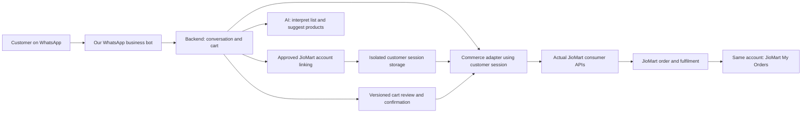

# Real JioMart account integration plan

Updated **18 October 2026**. Status: consumer OTP/session/refresh, saved addresses and location-dependent search **verified in one live test**; history, real cart/stock/checkout and a stable deployment contract remain open. (Historical note: the shopping-agent application now exists; see [project status](project-status.md).)

## 1. Required outcome

The customer uses ordinary WhatsApp to talk to our business bot, connects their **existing JioMart account**, shops against real JioMart assortment and availability, reviews the cart, and explicitly confirms a real purchase. The resulting order must be visible in **that same account's JioMart My Orders** and enter JioMart's normal fulfilment flow.

This is the user's scope correction on 18 October. A new merchant store, a separate customer identity created in our development channel, a guest checkout, or a synthetic order does not meet it. Development Company 153 and its synthetic catalog are historical experiments; they are excluded from this integration path. See [historical evidence](commerce-readiness.md).

**Login/payment UX clarification, 18 October:** the user accepts OTP entry inside WhatsApp if the actual JioMart integration supports it, or a browser login followed by return to WhatsApp. A hosted payment page/UPI handoff and return to WhatsApp are also acceptable. Shopping does not have to keep every authentication/payment screen inside the chat. These are accepted product options, not verified JioMart integration capabilities.

## 2. What the research establishes

**Later live evidence, 18 October:** the [sanitized API validation](commerce-api-validation-2026-10-18.md) supersedes earlier uncertainty about whether any direct real-account login/address/search calls can work. OTP, session and refresh succeeded for an existing customer; addresses and location-dependent search returned real data. The actual observed host is `api.jiomartjcp.com`; the web API gateway is `www.jiomart.com/api`, and search redirected to a storefront extension. History returned zero and remains unresolved. No real cart, payment or checkout was tested. The table below distinguishes the original published coverage from remaining deployment/contract questions; do not reset the tested account proof to unverified.

The [agent experience plan](whatsapp-agent-experience-plan.md) specifies how to build on this milestone without silently substituting products or overstating availability.

| Finding | Evidence | What remains unknown |
| --- | --- | --- |
| Jio Commerce publishes customer-facing catalog, cart, checkout and order APIs | [Storefront API introduction](https://partners.jiocommerce.io/help/docs/sdk/latest/application/client-libraries) | Whether the real JioMart consumer application exposes these contracts to our integration |
| Storefront requests use sales-channel application credentials | Same reference documents application ID/token authentication | Observed host/application recorded in validation; supported version and deployment entitlement still need agreement |
| Customer OTP, session, refresh and logout operations are documented | [User API](https://partners.jiocommerce.io/help/docs/sdk/latest/application/user) | Direct OTP/session/refresh worked; production session lifecycle and deployment support still need validation |
| Extension OAuth authorizes a seller/company | [Extension authentication](https://partners.jiocommerce.io/help/docs/partners/architecture/authentication/) | It does not supply the consumer account-linking contract |
| JioMart has fulfilled purchases through its own WhatsApp experience | [Reliance's September 2023 report](https://www.ril.com/sites/default/files/2023-11/29092023-MR-JioMart-and-Meta-celebrate-a-year-of-making-shopping-easier-for-India.pdf) | That first-party deployment does not establish third-party API availability |

The official pages reviewed did **not establish a public consumer OAuth/OIDC contract** for “Sign in to JioMart” from an independent bot. That is a research limitation, not a claim that no private or partner integration exists. A normal JioMart website login does not by itself hand a session to our backend.

The relevant integration is the **actual JioMart consumer commerce service**. Jio Commerce Storefront APIs are the documented candidate family. The platform owner must confirm whether that family, a JioMart-specific gateway, or the existing first-party WhatsApp integration is the supported entry point. A generic seller/OMS credential alone is insufficient evidence.

## 3. Authentication design

There are two separate permissions to establish:

1. **Integration access:** our service is permitted to call the actual JioMart consumer environment, using the issued application/client configuration.
2. **Customer access:** each shopper completes the supported login/authorization flow and grants the service the necessary account access. All account-specific operations remain bound to that customer.

The documented JCP application header is `Authorization: Basic base64(application_id:application_token)`. It identifies a sales channel, not a logged-in shopper. This is a candidate contract, not an instruction to use Company 153 credentials or the documentation's example host for JioMart.

### Accepted login journeys

**Option A — OTP within WhatsApp, using the demonstrated actual JioMart OTP API.** The backend starts the login challenge for the customer's chosen JioMart account, binds the challenge to that conversation, receives the OTP through a dedicated authentication handler and verifies it with JioMart. The handler must bypass the LLM and redact OTPs from application logs, traces and durable message copies. Retain challenge references and status, not the OTP. This does not claim that the customer's WhatsApp message history can be erased. Direct send/verify/session/refresh succeeded in the manual API test. The WhatsApp handler, expiry/attempt limits, durable encrypted storage and multi-customer isolation still need implementation and validation.

**Option B — browser login and return to WhatsApp.** This remains an accepted alternative requiring a supported callback/session handoff. OTP is the first implementation path after the successful API test:

1. Bot presents **Connect JioMart account** with a short-lived, single-use link bound to the WhatsApp business account, sender and pending linking attempt.
2. Customer opens the link and completes JioMart's approved login/consent flow in a browser. In this option, credentials and OTPs remain on the login screen and outside chat/model context.
3. Our registered callback receives the supported authorization result. If delegated OAuth/OIDC is offered, exchange the code using the supported flow with PKCE and validate issuer, audience, state and scopes. If JioMart instead provides an approved OTP/session bridge, implement its specified handoff. A link to the ordinary JioMart homepage is not a session-transfer mechanism: our website cannot simply read another site's login state. [Browser origin boundaries](https://developer.mozilla.org/en-US/docs/Web/Security/Defenses/Same-origin_policy).
4. Validate the account identity and linking transaction. Present **Back to WhatsApp** and complete the bound linking attempt in the originating conversation, showing a masked identity. The return link must contain no OTP, access token or refresh token. Do not rely on an automatic app switch being available on every device.

**Shared session handling:** keep the resulting customer session encrypted on the server, isolated by business account, application and customer. Give the AI only an opaque account reference. Support expiry, refresh where available, reconnect and disconnect; disconnect removes local access and invokes upstream revocation where supported. Confirm whether login can implicitly register an account and preserve the existing identity. A generic `loginWithToken` method does not prove arbitrary JioMart token exchange.

Do not infer account ownership from matching mobile numbers. Do not use a shared customer session or copied personal-browser cookies as the integration design. If neither supported delegation nor supported session handling exists, the integration dependency remains unresolved; another store does not satisfy the requirement.

## 4. Candidate API map

These are **published JCP candidate routes**, except for the subset explicitly tested in the linked validation record. The real production host and OTP/session/address/search calls are observed; validate each remaining operation and the supported version before enabling it. Paths with different versions are alternatives to validate, not a sequence to call together.

| Need | Documented candidate | Validation needed |
| --- | --- | --- |
| Start customer login | `POST /service/application/user/authentication/v1.0/login/otp` | Existing JioMart identity; approved OTP UI and session issuance |
| Verify OTP | `POST /service/application/user/authentication/v1.0/otp/mobile/verify` | Challenge binding, expiry, attempt limits and resulting session |
| Validate / end session | `GET /service/application/user/authentication/v1.0/session`; `GET /service/application/user/authentication/v1.0/logout` | Actual account and application identity; logout scope |
| Refresh session | `POST /service/application/user/authentication/v1.0/token/refresh` | Cookie/header requirements and trusted user context; no assumed bearer-token recipe |
| Search / inspect products | `GET /service/application/catalog/v1.0/products`; `GET /service/application/catalog/v1.0/products/{slug}` | Real assortment, search parameters, product and pack identifiers |
| Choose sellable variant / seller | `GET /service/application/catalog/v1.0/products/{slug}/sizes`; `GET /service/application/catalog/v4.0/products/{slug}/sizes/{size}/sellers` | Customer location, eligible store, price and stock; supported API version |
| Read saved addresses | `GET /service/application/cart/v1.0/address` (live-observed) | Default address read succeeded; address writes and final delivery eligibility unverified |
| Read / change cart | `GET`, `POST`, `PUT /service/application/cart/v1.0/detail` | Customer/cart binding; add/update/remove schema; totals and concurrent edits |
| Quote and select delivery address | Cart detail; `POST /service/application/cart/v1.0/select-address`; `GET /service/application/cart/v1.0/shipment` | Complete taxes, fees, discounts, minimums and delivery promise |
| Submit checkout | `POST /service/application/cart/v2.0/checkout` | Real JioMart order creation, payment sequencing and idempotency contract |
| Payment | `GET /service/application/payment/v1.0/payment/options`; `POST /service/application/payment/v1.0/payment/request`; `POST /service/application/payment/v1.0/payment/confirm/polling` | Enabled instruments, hosted customer interaction, authoritative status and retry behavior |
| History / order result | `GET /service/application/order/v1.0/orders`; `GET /service/application/order/v1.0/orders/{order_id}` | Existing JioMart history, newly created order visibility and reconciliation |
| Shipment tracking | `GET /service/application/order/v1.0/orders/shipments/{shipment_id}/track` | Visibility for this customer and supported status meanings |

Sources: [User](https://partners.jiocommerce.io/help/docs/sdk/latest/application/user), [Catalog](https://partners.jiocommerce.io/help/docs/sdk/latest/application/catalog), [Location](https://partners.jiocommerce.io/help/docs/sdk/latest/application/location), [Cart](https://partners.jiocommerce.io/help/docs/sdk/latest/application/cart), [Payment](https://partners.jiocommerce.io/help/docs/sdk/latest/application/payment), [Order](https://partners.jiocommerce.io/help/docs/sdk/latest/application/order). Reviewed 18 October 2026. The current documentation selector shows 1.10.7 as latest and also offers 1.10.3; this does not resolve Shyam's pilot-version reference.

Do not call checkout and a separate order-creation method to perform the same purchase. The supported payment/checkout sequence must identify which operation creates the commercial order and how an interrupted attempt is reconciled.

## 5. Proposed system flow

The backend owns authentication, cart state, confirmation, payment status and retries. The AI invokes bounded shopping operations; it neither holds tokens nor chooses customer IDs or arbitrary API URLs. Personalization uses only the linked account's permitted history and explicit preferences. OMS remains downstream of JioMart checkout rather than a second independently created order.

The customer's selected delivery address determines eligible stock, sellers, charges and delivery promises. Resolve how **T9G8** constrains the controlled pilot; it is a store code, not an application credential or permission to override serviceability. If the selected address cannot use the agreed pilot store, disclose that limitation.

Prefer JioMart's supported hosted payment/UPI flow. Keep payment pending, payment failed and order confirmed distinct. The exact order/payment sequence depends on the confirmed contract; neither COD nor an available payment-link flow is assumed.

### Payment handoff and return to WhatsApp

The user accepts a payment page or payment-app handoff. Proposed flow:

1. Show the final basket, delivery address, charges, total and payment choice in WhatsApp; bind customer confirmation to that cart/quote version.
2. Start one supported checkout/payment attempt and persist its customer, cart, order/payment references, amount and currency. JioMart may create a pending order before payment; do not assume the order is first created after the customer returns.
3. Send **Pay securely** using the URL issued by the enabled JioMart/payment integration. The customer completes payment there. A return page can offer **Back to WhatsApp**; credentials and session tokens stay out of that link.
4. The backend verifies payment through the supported authenticated status API and/or authenticated server notification, checking the expected attempt, order, amount and currency. A browser redirect or a customer saying “paid” is not proof of payment.
5. Complete any remaining operation required by the confirmed checkout contract, once, and retrieve authoritative order status. Send the verified order confirmation in WhatsApp. Do not create a second order when the customer returns or a callback repeats.
6. If the customer returns before confirmation, show payment/order pending and reconcile the same attempt. If the browser closes or the customer never taps Back, backend reconciliation still proceeds; payment/order completion must not depend on the return click. Reconcile unknown outcomes before offering another payment attempt.

The [Cart API](https://partners.jiocommerce.io/help/docs/sdk/latest/application/cart#checkoutCart) documents callback/payment URLs and order references; the [Payment API](https://partners.jiocommerce.io/help/docs/sdk/latest/application/payment) describes payment redirects and status operations. These support this proposed pattern, but actual JioMart methods, callbacks and sequencing remain to be confirmed. Scope is shopping in WhatsApp with supported login/payment handoffs, not a requirement to keep every screen inside WhatsApp.

## 6. Implementation order and proof

| Step | Work | Exit evidence |
| --- | --- | --- |
| 1. Resolve consumer access | Obtain the real integration contract and application configuration; confirm customer-login route and version | Owner-confirmed host, application identity, auth/session sequence, permitted operations and supported version |
| 2. Prove the same account | Link one existing JioMart test customer; read identity, saved addresses and bounded history where present | Returned identity and at least one existing account artifact match the customer's JioMart account; a genuinely empty account is recorded as such, not fabricated |
| 3. Prove real shopping data | Select address, search a real item, inspect sellable unit, create/update/remove a customer cart, obtain authoritative quote | Actual catalog/availability and correct totals under that customer; determine whether app/web and bot share a cart or have separate cart contexts |
| 4. Complete one real purchase through WhatsApp | Connect a minimal text/login/cart flow and verify WhatsApp delivery/replies. Present exact basket, address, charges and payment choice; after customer confirmation execute the supported purchase flow once | WhatsApp journey produces a real order ID, authoritative payment/order status, order visible in the same JioMart My Orders and expected fulfilment |
| 5. Expand the assistant experience | Add natural-language flexibility, voice, images and purchase-history ranking | Each input type invokes the proven customer-scoped operations; interpretation tests do not need extra purchases |

Progress against this proof sequence: actual host/application and direct OTP/session/address/search are observed; formal deployment/version support, history and real cart/checkout remain unresolved. The [experience plan](whatsapp-agent-experience-plan.md) now supplies the detailed implementation stages, including a text-draft stage that can use the proven subset. Step 4 is a real purchase with real payment/fulfilment consequences; the later test run needs the customer's exact cart confirmation. This research task has not placed an order or initiated a payment.

Reliability acceptance also includes two customers remaining isolated, an expired session requiring reauthentication, a changed price/address/cart invalidating old approval, and duplicate confirmations or timeouts never blindly causing a second checkout. If upstream offers neither reliable idempotency nor reconciliation, retain the unknown order state for operator resolution.

Handoff acceptance includes expired/reused login links, the wrong browser account, OTP routing outside the model, an early return from payment, a closed browser, duplicate notifications and ambiguous payment status. In all cases, identity remains bound and a return link alone cannot establish login or payment success.

## 7. Concrete integration request for Shyam / JioMart owner

Prepared for handoff; **not sent**. Include the [sanitized live validation](commerce-api-validation-2026-10-18.md) so the owner can confirm the observed contract and address remaining gaps rather than repeating the completed account proof.

> We are building a WhatsApp shopping assistant for an existing JioMart consumer account. After customer login, it must access that customer's permitted addresses/history, use real JioMart catalog and checkout, and create an order visible in the same JioMart My Orders. A new development storefront is outside scope. Please identify the supported consumer integration route and provide its contract and access configuration through the appropriate secure channel.

Needed artifacts:

- Confirmation of the observed JioMart consumer host/application for supported bot deployment, API/SDK version, access owner and required registration/allowlisting.
- Production contract for the demonstrated OTP/session/refresh path: permitted scopes, session lifecycle, identity mapping, expiry, logout/revocation and redacted examples. Browser delegation/callback is an optional alternative requiring its own handoff contract; OTP is the first planned path.
- Customer-address/history visibility and whether orders created through this integration appear in the same JioMart account; confirm cart sharing behavior separately.
- Catalog/search, location/serviceability, variant/seller, pricing/stock and T9G8 pilot mapping contracts.
- Cart/quote/address selection, enabled payment methods, issued hosted payment URLs and return URL support, authenticated status/callback handling, checkout/order creation sequence, idempotency and lookup after timeout. Browser/UPI payment and return to WhatsApp are acceptable; consumer integration support remains the dependency.
- Controlled real-order test arrangements: selected customer and delivery area, normal payment and fulfilment behavior, and operational handling of failed/duplicate attempts. This must still produce a real JioMart order, not silently substitute a sandbox order.

## 8. Current readiness

**Proven manual API calls:** existing-account OTP/session/refresh, saved default address and pincode-dependent search. **Unresolved:** history, correct search pagination, exact quantity stock, cart/quote/checkout/payment, order reconciliation/visibility, T9G8 mapping and the supported deployment/version contract. **Reusable application:** none.

The next work is the [agent experience/build plan](whatsapp-agent-experience-plan.md): repeatable contracts and WhatsApp proof, a truthful text shopping draft, then gated cart and real-purchase work. Retain the [validation record](commerce-api-validation-2026-10-18.md) as evidence; a successful manual login is not a deployed bot.

There is no reason to continue the development-store address/mobile checkout task. Its previous request for a test mobile is superseded. The [PRD](technical-prd.md) and [status](project-status.md) carry this corrected scope forward.
