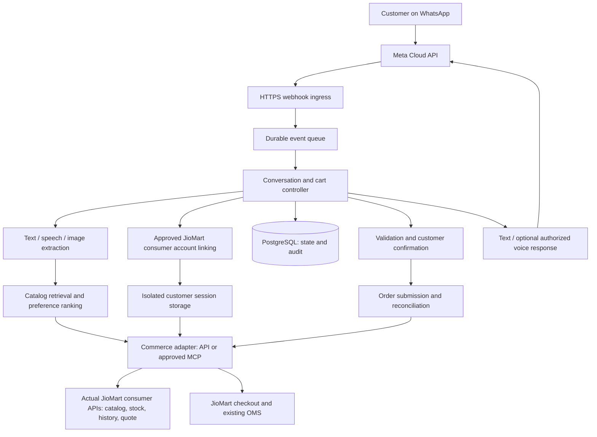

# SmartBazaar WhatsApp AI Shopping Agent

## Technical Product Requirements Document

| Document field | Value |
| --- | --- |
| Version | 1.3 — local login/search POC and verified account/search milestone, 18 October 2026 |
| Prepared | 15 October 2026 |
| Product concept | Instinct for SmartBazaar |
| Intended pilot | One SmartBazaar darkstore: **T9G8**, subject to environment and company mapping |
| Current stage | Local login/search POC exists; real-account OTP/address/search manually verified; live messaging/cart/checkout remain incomplete |
| Audience | POC engineering team, Farooq, Shyam, SmartBazaar pilot stakeholders |
| Status | Requirements plus a local, intentionally limited implementation; not a claim of live channel or commerce integration |

This document consolidates the original bilateral note, the complete available conversation titled **Explain Shopping Agent Task**, this continuation, and the attached screenshot of Shyam's guidance. It captures the intended product, decisions, implementation proposals, setup progress, unresolved dependencies, and acceptance criteria in one place. Passwords, access tokens, API secrets, OTPs, and the test customer's full personal phone number are intentionally excluded.

**Navigation:** [Objective](#1-product-objective) · [Evidence](#2-evidence-authority-and-interpretation) · [Scope](#4-scope-and-delivery-levels) · [Requirements](#6-functional-requirements-and-acceptance) · [Architecture](#7-proposed-technical-architecture) · [Data](#9-data-requirements) · [Commerce integration](#10-commerce-apis-mcp-and-access) · [WhatsApp status](#11-whatsapp-setup-actual-progress-and-remaining-work) · [Acceptance](#14-evaluation-and-acceptance-plan) · [Delivery](#15-delivery-plan-and-dates) · [Shyam dependencies](#16-dependencies-and-questions-for-shyam)

## 1. Product objective

Build a WhatsApp shopping assistant that connects the customer's **existing JioMart account**, turns their grocery list into a personalized, reviewable cart, and after explicit confirmation creates a **real JioMart order visible in the same account's My Orders** through existing commerce and fulfilment infrastructure.

**Scope decision, 18 October 2026:** the user excluded a new/dummy store or separate development storefront from the POC path. The previous Company 153 experiment is historical evidence only. The current [JioMart account integration plan](jiomart-account-integration-plan.md) defines the consumer-access dependency and proof sequence. This supersedes earlier fixture/store fallback proposals for POC acceptance; original reference material remains intact.

The consolidated target flow is:

**WhatsApp → connect existing JioMart account → voice note / handwritten-list photo / text → item extraction → real catalog matching → authorized purchase-history personalization → availability and price validation → cart review and corrections → customer confirmation → supported JioMart checkout/payment → real order in the same account → acknowledgement.**

Voice/image input, personalization, cart confirmation, and OMS routing come from the source. Text input, explicit validation controls, and detailed correction/acknowledgement behavior are proposed engineering additions that support that experience.

Customers should not need to install a separate shopping app or specify every brand and pack size on every purchase. For example, a request for “dahi” can produce an Amul 400g suggestion when the customer's authorized purchase history supports that preference. The selected product still needs to be available, correctly priced, and visible in the cart before ordering.

The complete source concept also includes spoken responses in the store manager's voice and continuity when the manager changes. This is a desired product capability, not something the discussion formally removed from scope. [S1, pp. 1–2]

### 1.1 Business context

The bilateral note proposes a SmartBazaar-controlled digital relationship and home-delivery experience, built as a sidecar to existing commerce systems. It discusses changing strategic dependence on JioMart and reports an internal **34% increase in family basket size** from digital delivery in Gaya, Bhuj, and Hathras. This figure is meeting context reported in the source, not independently validated evidence, an experiment result for this POC, or a committed POC target. [S1, pp. 1–2]

The source combines SmartBazaar's **one-store-one-customer relationship data**, the store's fulfilment capability, Fynd's existing OMS/platform execution, and frontier AI/voice technology. Its intended transition is directly from the familiar physical store relationship to an AI assistant on the store's WhatsApp identity. [S1, pp. 1–2]

The initial task is to prove that the assistant can understand real shopping inputs and complete the ordering journey with existing commerce rails. A general chatbot, a catalog-only search assistant, or a cart demo described as successful OMS integration would not satisfy the full concept.

## 2. Evidence, authority, and interpretation

Requirements in this PRD use the following classifications:

| Label | Meaning |
| --- | --- |
| **Source requirement** | Explicitly described in the original bilateral note |
| **Discussion decision** | Stated by the user or supported by shared stakeholder evidence |
| **Observed setup** | Verified by browser or direct API test as explicitly recorded; last observation, not continuous monitoring |
| **Proposed design** | Engineering recommendation in this PRD; can change without contradicting the source |
| **Open dependency** | Cannot be assumed until access, behavior, or stakeholder agreement is confirmed |

Current explicit user decisions govern scope, including corrections to earlier proposals or source interpretations. Preserve the historical source document and stakeholder evidence; use observed service state for setup progress, official documentation for published capabilities, and prior assistant suggestions for proposals only. Documentation showing an API capability does **not** prove real JioMart consumer access, T9G8 enablement, or compatibility with the pilot version.

### 2.1 Source register

| ID | Source | Use in this PRD |
| --- | --- | --- |
| S1 | `Instinct_for_SmartBazaar_Bilateral_Note_2026-10-15.pdf`, all four pages, attached to the earlier conversation | Original experience, business rationale, stakeholders, pilot approach, dates, manager voice concept |
| S2 | [Explain Shopping Agent Task](chatgpt-conversation://6ad0800a-35dc-8320-bdca-93a7901e47da), all available turns reviewed | Scope clarifications, API/data discussion, implementation options, access questions |
| S3 | This continuation and browser observations | Meta asset creation, verified recipient, outstanding token authorization, failed direct-chat lookup, user preferences |
| S4 | `Screenshot 2026-10-15 at 4.37.35 PM.png`, attached to S2 | Shyam specifies T9G8, shares Jio Commerce docs, mentions version 1.10.3, and suggests creating personal JioMart purchase history |
| S5 | [Jio Commerce extension getting started](https://partners-doc.jiocommerce.io/help/docs/partners/extension/general/get-started/) | Extension/development-company route and test-data tooling |
| S6 | [Jio Commerce Platform API](https://partners-doc.jiocommerce.io/help/docs/sdk/latest/platform/client-libraries) | Platform capability categories and company/extension authentication |
| S7 | [Jio Commerce Storefront API](https://partners-doc.jiocommerce.io/help/docs/sdk/latest/application/client-libraries) | Application-facing commerce capabilities and application authentication |
| S8 | [Jio Commerce extension authentication](https://partners-doc.jiocommerce.io/help/docs/partners/architecture/authentication/) | Company authorization and scoped OAuth access |
| S9 | [Meta's WhatsApp test-message request](https://www.postman.com/meta/whatsapp-business-platform/request/9php9mt/send-test-message) | Outbound test request through a phone-number ID |
| S10 | User scope correction, 18 October 2026, in this chat | Existing JioMart account, customer-authenticated backend and actual JioMart order; excludes dummy-store route |
| S11 | [JioMart account integration research](jiomart-account-integration-plan.md), 18 October 2026 | Primary API references, authentication distinction, validation and remaining deployment dependencies |
| S12 | [Real-account API validation](commerce-api-validation-2026-10-18.md), 18 October 2026 | Successful OTP/session/refresh/address/search calls, broad search results, unresolved pagination/history and untested checkout |
| S13 | User request and [WhatsApp agent experience plan](whatsapp-agent-experience-plan.md), 18 October 2026 | Exact-product validation, compact choices, intelligent context use, explicit substitutes and staged build plan |

S5–S9 were consulted during consolidation. The current Meta webhook documentation URL returned HTTP 429 during this review; this PRD therefore treats the dashboard warning recorded in S3 as an observed constraint requiring a live test, rather than presenting an unverified universal webhook rule. The original PDF and screenshot are not embedded; their relevant contents and provenance are consolidated here.

### 2.2 Corrections to earlier assumptions

1. A Facebook account already existed and was signed in as Ganesh E. A new Facebook account was not created in this task.
2. A claimed WhatsApp test number is not proof of usable two-way chat. The user saw “This phone number isn't on WhatsApp,” and no successful send/reply was verified.
3. Earlier statements about unlimited free messages, fixed token lifetime, Twilio trial allowances, or guaranteed test-number chat are not acceptance assumptions. Verify current account limits and token expiry when configuring the integration.
4. Real order routing is part of the source concept. S10 further requires an actual JioMart purchase under the same existing customer account; a mock OMS or development-store order cannot satisfy POC acceptance.
5. The PDF does not specify CSV versus API, data volumes, exact schema, model provider, API endpoints, or a customer-identification mechanism.
6. Text input, inventory validation, serviceability checks, and detailed data fields are implementation requirements/proposals supporting the experience; the source specifically describes voice notes and handwritten-list images.
7. Store-manager voice was proposed for deferral in earlier advice, but no stakeholder approval of that deferral is recorded.
8. T9G8 is a supplied darkstore code. It is not a confirmed company ID, application ID, numeric store ID, or proof of data access.
9. Creating API credentials for an unrelated development company does not establish access to SmartBazaar's data.
10. Published seller extension OAuth is not consumer “Sign in to JioMart.” A sales-channel login using the same mobile number does not prove the same JioMart identity, history or order visibility. [S11]

## 3. Stakeholders and responsibilities

| Person/team | Recorded or proposed responsibility |
| --- | --- |
| Damodar Mall | Source-note chair and SmartBazaar field-test owner; reviews first pass and engages the omnichannel pilot team |
| Farooq Adam | Source-note build lead, stakeholder synthesis, and prototype ownership |
| Ganesh / POC engineering team | Current implementation coordinator; agent, backend, channel integration, evaluation, and technical delivery |
| Shyam | SME — Subject Matter Expert — for relevant APIs/MCP, data access, field validation, and commerce integration; supplied pilot guidance |
| SmartBazaar omnichannel pilot team | Consumer/field testing and operational feedback |
| Amit | Source-note observer, later contributor after Granary; timing not confirmed in this task |
| Commerce/platform owner | Confirms company/application access, sanctioned checkout route, test-order behavior, and fulfilment boundaries; exact owner to confirm |

The user explicitly clarified that the team can manage external solutions such as LLMs itself. Requests to Shyam should focus on **SmartBazaar data, commerce APIs/MCP access, environment identifiers, schemas, validation, and business rules**, rather than asking him to select or provision unrelated AI/hosting services.

The note mentions Instinct, Meta Muse, KT's Jio bot, and Claude voice conversation as context or inspiration. They are not selected software dependencies. Its sentiment/tone discussion is explicitly contextual rather than formal minutes. [S1, pp. 2–4]

## 4. Scope and delivery levels

### 4.1 Source-led scope

The classification applies to each capability. The outcome column translates the concept into implementation behavior; detailed extraction fields and conversational uncertainty handling are derived acceptance details, not verbatim specifications from the PDF.

| Capability | Classification | Required outcome |
| --- | --- | --- |
| WhatsApp entry point | Source requirement | Customer interacts without a new standalone app |
| Existing JioMart account | Discussion decision, S10 | Customer completes supported JioMart login; backend acts only under that customer's permitted session |
| Voice-note understanding | Source requirement | Extract grocery intent, items, quantities, and constraints |
| Handwritten-list understanding | Source requirement | Read a photographed list and resolve uncertainty conversationally |
| Purchase-history personalization | Source requirement | Suggest familiar products/brands/pack sizes using authorized history |
| Product substitutions | Source requirement | Offer appropriate alternatives within the shopping conversation |
| Interpreted cart and confirmation | Source requirement | Customer sees and approves the intended basket |
| Routing to store OMS | Source requirement, narrowed by S10 | Real JioMart checkout creates an order in the same customer's account and normal fulfilment rails |
| Manager voice and continuity | Source requirement | Familiar authorized voice can change with the manager while persona continuity remains |
| Tier 2+ sidecar pilot | Source requirement | Small controlled pilot outside mainstream platform changes |
| T9G8 pilot store | Discussion decision, S4 | Resolve actual IDs and eligibility within the real JioMart customer-address/serviceability flow |

### 4.2 Proposed implementation scope

**Core build:** text, voice, image input; structured extraction; catalog search; preferred-product suggestions; cart edits; price/stock validation; clarification; substitution approval; versioned confirmation; order submission and acknowledgement; retry safety; basic operational logs and evaluation.

**Voice milestone:** add spoken replies and an authorized manager voice profile, plus safe replacement of the active voice. Generic speech or text-only responses may unblock development, but must be described as a temporary reduction in the original experience and accepted by the product owner before calling the full concept delivered.

**Out of the first controlled POC unless checkout requires them:** custom payment gateway integration, refunds/cancellation workflows, proactive campaigns, loyalty administration, multi-store routing, warehouse management, a full shopping application, production-scale analytics, and a full customer-service console. Order tracking can be a later feature; order lookup for submission reconciliation is required technical support for reliable ordering.

Payment, address, and delivery fields cannot be omitted when required by JioMart checkout. Use its supported checkout/payment flow and the customer's selected delivery address. A sandbox checkout cannot substitute for the required real-order proof. Do not assume COD is available.

### 4.3 What each milestone proves

| Delivery level | Permitted claim | What remains unproven |
| --- | --- | --- |
| Consumer account proof | Existing JioMart customer signs in through the supported integration; identity and existing account data match | Shopping, payment and order creation |
| Real cart proof | Real serviceable catalog, customer cart and authoritative quote work | Real order submission and WhatsApp experience |
| Integrated POC | WhatsApp journey creates one explicitly confirmed real JioMart order visible in the same account | Broad rollout, scale and delivery outcome until actually observed |
| Controlled consumer pilot | Agreed customers use the proven real-account journey with operational support | Broad production rollout |

Local test fixtures can exercise extraction and failure handling, but are not an alternative POC milestone. Every demonstration must disclose simulated components; a fixture-backed cart must never submit to live commerce.

## 5. Customer experience

The detailed [WhatsApp agent experience/build plan](whatsapp-agent-experience-plan.md) expands this section with 22 user use cases, decision rules, conversation examples, location handling and capability gates. It is a proposal for implementation, not implemented behavior. [S13]

### 5.1 Returning customer

1. Customer sends a voice note, list photo, or text to the configured WhatsApp identity.
2. Backend verifies the incoming event. If no valid account link exists, it presents **Connect JioMart account**. The user accepts OTP inside WhatsApp if supported or browser login with a supported callback/session handoff and return to chat. The backend binds the verified JioMart identity to that conversation, then resolves the selected address and eligible store context.
3. Agent extracts items, quantities, and explicit constraints; retrieves permitted purchase history.
4. Product retrieval identifies real candidates from the pilot catalog. History ranks likely brands and pack sizes where the request is underspecified.
5. Agent asks short questions for meaningful uncertainty, such as which milk variant or whether “two” means packs.
6. Current availability and prices are checked. Unavailable items produce approved alternatives or an option to remove the line.
7. Customer receives a readable cart showing product, pack size, quantity, price, adjustments, and total. Address and delivery/payment requirements appear when applicable.
8. Customer can correct items or explicitly confirm the current cart.
9. Backend revalidates the approved version and follows the supported JioMart checkout/payment sequence under the same customer session. A hosted payment page/UPI handoff and return to WhatsApp are acceptable. The backend verifies payment and order status independently of the customer's return click; a pending order may already exist before payment.
10. Only an authoritative order result produces a success message; the real order reference must also appear in that customer's JioMart My Orders.

### 5.2 New or unmapped customer

No purchase history is assumed. The assistant helps choose products through brief clarification. It must complete the platform-approved identity flow before accessing account-specific history or submitting an order under an existing customer account. Possession of a WhatsApp sender number alone does not automatically authorize a JioMart customer session.

The accepted login/payment handoffs are specified in the [integration plan](jiomart-account-integration-plan.md). In-chat OTP, if supported, goes directly to the authentication handler and stays out of LLM context and application logs/storage. Browser login requires a registered authentication handoff; opening JioMart's ordinary login page does not automatically expose its session. Both paths use isolated, encrypted server-side sessions with expiry and reconnect handling.

### 5.3 Substitutions and changed stock

The assistant proposes a real available alternative with its brand, pack size, price, and reason. A brand or size change is a proposal, not a silent replacement. If the customer declines, offer another candidate or remove the item. If stock or price changes after confirmation, refresh the cart and request confirmation of the changed version.

### 5.4 Multimodal correction

If a photo is unclear or a voice note is noisy, preserve confidently understood lines and ask about the uncertain ones. Allow a text correction without requiring the customer to resend the entire list. “Make the milk three” should update the identified milk line once, not add three more packs unless that is explicitly intended.

### 5.5 Voice identity

The assistant identifies itself as an AI assistant. When an authorized manager voice is configured, it can speak the response in that voice; the written cart remains available for exact SKU, price, and confirmation review. Replacing a manager changes only the active voice profile and allowed persona metadata, not customer identity, order state, or historical purchases.

## 6. Functional requirements and acceptance

All requirements below are proposed engineering acceptance conditions unless the basis identifies a source requirement. They describe target behavior, not current implementation.

| ID | Requirement | Acceptance condition |
| --- | --- | --- |
| FR-01 | Receive WhatsApp text, audio, and image messages | Supported inbound event creates one durable work item and routes to the correct conversation |
| FR-02 | Extract grocery lines | Produces schema-valid items with original phrase, quantity/unit interpretation, constraints, and uncertainty |
| FR-03 | Preserve intent across languages | Pilot language test set passes agreed targets; unsupported input triggers clarification rather than fabricated interpretation |
| FR-04 | Retrieve real catalog candidates | Every offered sellable item maps to a valid product/variant/store record; no invented SKU |
| FR-05 | Use customer history | Only the authorized customer's history influences ranking; explicit current instructions override inferred preferences |
| FR-06 | Resolve ambiguity | Uncertain brand, pack size, quantity, or product is clarified before final approval |
| FR-07 | Validate inventory | Checks relevant store and sellable unit; stale/unknown stock is not presented as confirmed availability |
| FR-08 | Suggest substitutions | Changed brand/pack/variant is disclosed and accepted before being treated as approved |
| FR-09 | Maintain a durable cart | Add, update, remove, and restart actions have clear semantics and survive worker/server restart |
| FR-10 | Obtain authoritative quote | Totals and applicable charges come from the agreed pricing/checkout source, not model arithmetic |
| FR-11 | Collect checkout requirements | Enforces the actual schema and serviceability rules; unsupported address/payment state blocks submission |
| FR-12 | Bind confirmation to cart version | Records actor, inbound message ID, cart version, displayed quote, and approval time; older approval cannot confirm a changed cart |
| FR-13 | Submit one order | Same customer confirmation cannot produce duplicate orders under concurrent processing or webhook redelivery |
| FR-14 | Verify order result | Success requires a reconciled external order ID; ambiguous responses remain pending/unknown until resolved |
| FR-15 | Respond with voice | Source voice experience is demonstrated or explicitly deferred; text fallback preserves the cart and next action |
| FR-16 | Switch manager voice | Authorized new voice can replace active voice with auditable versioning; old voice stops being used |
| FR-17 | Separate fixture and live modes | Each adapter declares its mode; incompatible data/order modes cannot cross-submit |
| FR-18 | Handle failures understandably | Customer sees an accurate pending, retry, clarification, or failed state; never a false order success |
| FR-19 | Observe the journey | Correlated inbound event, model call, tool call, cart version, confirmation, and order attempt can be traced without exposing secrets |
| FR-20 | Enforce account/store boundaries | Unauthorized customer, application, company, or store changes are rejected server-side |
| FR-21 | Link an existing JioMart account | Supported login establishes the actual customer identity and permitted account data; a separate development-store identity does not pass |
| FR-22 | Preserve same-account order visibility | Confirmed real purchase is retrievable through the integration and visible in the customer's JioMart My Orders |

**Language proposal:** Hindi, English, and Hinglish for initial evaluation, adding the selected pilot market's regional language only after confirmation. The PDF does not specify an exhaustive language list. Avoid promising support for every language a model can process.

## 7. Proposed technical architecture

Use a small application with clear modules and a background worker. A large autonomous multi-agent system, bespoke microservices, and a vector database are not prerequisites for this POC.



### 7.1 Components

| Component | Proposed implementation | Responsibility |
| --- | --- | --- |
| Webhook/API service | Python + FastAPI baseline; final choice subject to compatible commerce SDK | Verify events, authorize requests, expose controlled application endpoints |
| Worker | Same repository/process family, deployed separately if needed | Media extraction, model calls, commerce operations, retries |
| Durable state | PostgreSQL | Conversations, cart versions, event deduplication, order attempts, customer mapping references |
| Work queue | PostgreSQL-backed jobs initially; Redis optional if operationally justified | Durable asynchronous processing and per-conversation ordering |
| Media storage | Private object storage or controlled temporary storage | Short-lived audio/image processing with cleanup |
| Model adapter | Provider-neutral interface | Structured extraction, conversational clarification, constrained ranking |
| Commerce adapter | Authorized REST/SDK integration or an approved MCP server | Translate our internal contracts to the real pilot schema |
| Customer account linking | Direct OTP/session/refresh proved manually; production lifecycle unimplemented | Bind existing customer identity to WhatsApp, isolate sessions, handle expiry/reconnect/disconnect |
| Speech output | Optional TTS adapter; manager voice requires approved enrollment | Spoken response generation |
| Observability | Structured logs, metrics, trace IDs, small operator view | Diagnose failures and measure the pilot |

### 7.1a Implemented local login/search POC — 18 October 2026

The repository now contains a deliberately limited Python/FastAPI implementation: signed/allowlisted Meta webhook ingress, an in-memory inbound queue, encrypted SQLite sessions and persistent outbox, OTP-first conversation handling, JioMart OTP/address/search adapter methods, and a constrained OpenAI Responses intent/ranking adapter. It exposes no cart, quote, payment, checkout or order operation. A restart interrupts in-memory inbound work and requires resend; only the encrypted outbox is restart-persistent. This implementation is a local POC and does not replace the production architecture proposed above.

One local `gpt-6.1-sol` structured-output call and bounded rank were observed. The JioMart adapter recognizes an observed public catalog route redirect to an allowlisted `/ext/vertex/` path, but its live use through this POC and durable integration contract remain pending. Catalog results remain candidate evidence only; listing price/sellability do not prove stock, cart or checkout readiness.

Python/FastAPI/PostgreSQL were earlier suggestions, not selected production dependencies. If JCP version compatibility or team ownership favors another runtime, preserve the contracts and state guarantees rather than forcing this stack.

### 7.2 LLM and media processing

Earlier options included Gemini/Google multimodal models, OpenAI models/transcription, ElevenLabs or another TTS provider, and optional OpenAI Agents SDK/LangGraph orchestration. None is committed here, and no provider credentials are confirmed configured.

Select a text/multimodal model using the actual grocery evaluation set. Compare extraction accuracy, structured output reliability, Hindi/Hinglish handling, latency, data-handling fit, and measured cost. Use one provider where it meets requirements; introduce separate speech/OCR models only if evaluation warrants them. Validate current model names and supported media formats before implementation.

The model may interpret and propose. Deterministic backend logic validates products, permissions, prices, inventory, cart versions, and order submission. The model must not construct arbitrary commerce URLs, retrieve arbitrary customer records, change tenant/store context, or place orders directly from free text.

### 7.3 Request processing

1. Verify the webhook request and supported account/phone-number identifiers.
2. Deduplicate and durably persist the event before returning a successful acknowledgement; if persistence fails, allow provider retry rather than silently losing the message.
3. Serialize customer/cart mutations using a conversation lock or equivalent transaction/version check.
4. Normalize the input; fetch provider media through authenticated, allowlisted paths when needed.
5. Extract structured intent and grocery lines; reject invalid model output or request clarification.
6. Retrieve bounded catalog candidates and permitted preference evidence.
7. Apply intent to the durable cart and call commerce validation/quote operations.
8. Send the next customer-facing response and record delivery status separately from order state.

## 8. Conversation and order state

### 8.1 Conversation state model

```text
NEW -> IDENTIFY_CUSTOMER -> COLLECTING_ITEMS
COLLECTING_ITEMS -> CLARIFYING -> BUILDING_CART
BUILDING_CART -> AWAITING_CONFIRMATION
AWAITING_CONFIRMATION -> BUILDING_CART        (customer edits or changed quote)
AWAITING_CONFIRMATION -> VALIDATING          (explicit current-cart approval)
VALIDATING -> AWAITING_CONFIRMATION          (material cart/price/stock change)
VALIDATING -> SUBMITTING                    (approved state remains valid)
SUBMITTING -> ORDER_CONFIRMED               (verified OMS success)
SUBMITTING -> AWAITING_PAYMENT              (supported flow needs customer payment)
AWAITING_PAYMENT -> RECONCILING             (payment status update or uncertain outcome)
SUBMITTING -> RECONCILING                   (outcome unknown)
RECONCILING -> ORDER_CONFIRMED | AWAITING_PAYMENT | FAILED | NEEDS_REVIEW
```

An abandoned session can expire without cancelling an already-created order. “Cancel” during cart preparation means abandon the draft; after order creation, do not imply cancellation unless the separate OMS cancellation capability is implemented and authorized.

Payment status and order status are separate records. This is a conversation workflow, not a claimed JioMart state enum or fixed payment-before-order sequence. Browser return is navigation only; authoritative server-side verification drives completion even if the user closes the page. Repeated returns/notifications must reconcile the same attempt, never blindly create another order or charge.

### 8.2 Confirmation rules

- Display the current item list, sellable pack/variant, quantities, quote currency/total, known charges, and applicable fulfilment details.
- An explicit button or unambiguous response can confirm only the current pending cart. Bind it to the relevant message/cart version.
- A line edit, substitution, address change affecting serviceability, payment change, expired quote, or changed total invalidates the previous confirmation.
- Revalidate immediately before submission. Ask again when customer-visible commitments change.
- A customer saying “yes” to a product clarification is not automatically an order-placement approval.
- A voice reply can express intent, but if transcription is uncertain or multiple confirmations are pending, ask for a clearer confirmation.

### 8.3 Exactly-once business effect

Assume messaging and job delivery can occur more than once. Enforce a unique inbound-event key and a unique order-submission key based on conversation/cart/approval identity. Persist an order-attempt record before calling the commerce service and use its supported idempotency mechanism if available.

An HTTP timeout after a submission does not prove failure. Reconcile using the approved external reference/order lookup before retrying a create operation. If the upstream system lacks both idempotency and reliable lookup, stop in `NEEDS_REVIEW` rather than risking duplicate orders. Message retry and order retry are independent operations.

## 9. Data requirements

These are proposed canonical fields for our integration contract. They are **not** claimed to be the exact Fynd/Jio Commerce payload schema. Shyam/platform documentation must confirm the mapping and validation rules for the pilot version.

### 9.1 Required datasets

| Dataset | Minimum fields/meaning | Source and use |
| --- | --- | --- |
| Store context | External store code, actual store ID, company ID, application/channel ID, active/serviceability metadata | Resolve T9G8 and prevent cross-store reads/orders |
| Product catalog | Product ID, sellable SKU/size/variant ID, name, brand, category, pack value/unit, active status | Match customer language to real sellable units |
| Catalog enrichment | Alternate names/synonyms, descriptions, images, taxonomy, barcode where useful | Improve retrieval and understandable product choices |
| Pricing/quote | Currency, unit price, quantity, discounts, tax/fee treatment, totals, quote/reference and freshness | Display and submit authoritative cart amounts |
| Inventory | Store ID, sellable identifier, availability, quantity if exposed, timestamp | Validate requested quantities and alternatives |
| Customer mapping | Internal test identity, authorized external customer ID, tenant/channel scope, sender mapping | Safely resolve the WhatsApp customer |
| Purchase history | External customer, order/date, purchased sellable identifiers, quantities; historical brand/pack when catalog changed | Infer repeat preferences using actual item-level evidence |
| Delivery/checkout | Address reference or required fields, serviceability result, permitted delivery/payment choices | Satisfy the approved checkout contract |
| Order result | External order ID/reference, accepted/rejected/pending state, item/totals snapshot, error details | Acknowledge and reconcile submission |
| Voice profile | Store, approved speaker/profile reference, consent reference, version, active interval | Controlled manager voice and replacement |

Do not request bulk personal data simply because it was suggested in an earlier answer. Start with the implementing user's authorized test account and the smallest useful evaluation fixtures. Name, loyalty ID, full address, and broad purchase history are required only where the specific flow needs them.

### 9.2 Purchase history and JioMart

Shyam suggested treating ourselves as JioMart customers and creating purchase history. The current requirement is direct integration with that existing JioMart account; imports or fixtures can support isolated testing but do not prove account access. [S4; S10]

Do not assume all JioMart orders are visible through a company's application credentials. Confirm account mapping, channel/store linkage, customer authorization and history scope. First validate an existing account artifact where available; do not purchase merely to manufacture history. The final POC requires a separately customer-confirmed real order, visible in that same account. A genuinely new customer may have empty history and must still be able to shop.

Purchase history is needed primarily for **product personalization**: preferred brand, pack size, previously purchased SKU, and repeat quantities. It is not needed to make broad demographic inferences. Customers with no usable history must still be able to shop through clarification.

### 9.3 Initial data volume

Earlier suggestions ranged from 500–1,000 products, 20–50 customer histories, 6–12 months of history, and 30–50 examples per media type, with larger customer counts mentioned for later evaluation. These were planning suggestions, not requirements from the PDF or commitments from SmartBazaar.

For the integration proof, begin with one existing authorized customer and a few real serviceable products. Use small local fixtures only for unit/error-case tests. Expand to representative pilot products and permitted histories after actual account access is proven; coverage matters more than arbitrary record counts.

### 9.4 Internal entities

| Entity | Key attributes and constraints |
| --- | --- |
| `CustomerMapping` | Tenant/application + sender identity → authorized customer reference; verification method and timestamp |
| `AccountLink` | Single-use linking attempt, bound WhatsApp identity, verified JioMart identity, consent/expiry state and encrypted session reference; no credentials in model context |
| `Conversation` | ID, customer reference, store context, locale, state, active cart ID, expiry |
| `InboundEvent` | Unique provider/account/message key, event type, received time, processing state, retry count |
| `ExtractedList` | Source event/media, transcript/text reference, structured items, extraction version, unresolved fields |
| `PreferenceEvidence` | Customer, category/SKU/brand/pack, source order references, last observed date |
| `Cart` / `CartLine` | Cart ID/version, sellable identifiers, quantities, match rationale, approval/substitution status |
| `Quote` | Cart version, source, currency, totals, validity metadata, inventory-check time |
| `Confirmation` | Cart/quote version, sender, inbound confirmation ID, timestamp, exact summary reference |
| `OrderAttempt` | Unique submission key, commerce mode, external reference, state, sanitized request/response summary |
| `OutboundMessage` | Provider message ID, correlation ID, content type, send/delivery state |
| `VoiceProfile` | Store, provider profile ID, consent reference, version, active status |

Use integer minor currency units or a decimal money type, never binary floating-point totals. Distinguish customer-requested weight/volume from number of sellable packs. Define unit conversion rules; do not silently round a requested weight into a different basket.

## 10. Commerce APIs, MCP, and access

### 10.1 Current evidence

**18 October live milestone:** direct OTP/session/refresh, saved default address and location-dependent catalog search succeeded for an existing real JioMart customer. Search reported 64 broad results; the requested first 10 product records were preserved in full. History still returned zero and remains unresolved; pagination repeated the first page. No real cart, quantity-stock validation, payment or order was tested. See the [sanitized validation](commerce-api-validation-2026-10-18.md). The actual JioMart account and real-order requirement remains mandatory. Read the [current integration plan](jiomart-account-integration-plan.md) before any setup. The development experiment below is historical and is not the POC route; its missing checkout mobile is no longer an active dependency.

**17 October setup update:** On 17 October 2026, development Company **153**, application **`6ad295642243111f24dd498f`**, and store **2962 / HS-e93f6** were verified. The created **SmartBazaar POC Development** client authenticates against **`https://api.jiocommerce.io`**. A synthetic brand **POC Test Groceries** (24868) and product **POC Test Rice 1 kg** (82146727; SKU `POC-RICE-1KG-001`, size OS) were created. Store stock is **20**, MRP **₹100**, selling price **₹90**. Product, brand and inventory API read-backs returned **200 with one item** after stocking. The storefront guest cart was tested at quantity 1 → 2 → 1, with totals ₹90 → ₹180 → ₹90. No order was placed. Customer list is empty; guest checkout requires test mobile/address inputs and reports a Maps error. T9G8 access, customer history, direct storefront API session bootstrap and order behavior remain unverified. See [commerce readiness](commerce-readiness.md) for exact endpoints, sanitized evidence and limitations.

Shyam provided **T9G8**, the Jio Commerce documentation, and **version 1.10.3**. The current `latest` Storefront reference displayed a later version during this review, so implementation must pin the pilot's actual supported version. Shyam's version reference needs confirmation as to whether it denotes platform, SDK, or a particular API release. [S4; S7]

The published Platform and Storefront references expose catalog, cart/checkout, order, customer, inventory/location, and related capabilities. The customer-history calls remain unresolved; quantity stock, authoritative cart pricing and the sanctioned order path for this pilot remain unverified. Treat the capability mapping below as integration work to validate, not evidence of working calls. [Platform reference](https://partners-doc.jiocommerce.io/help/docs/sdk/latest/platform/client-libraries), [Storefront reference](https://partners-doc.jiocommerce.io/help/docs/sdk/latest/application/client-libraries).

### 10.2 Authentication options

Resolve two distinct permissions: integration access to the actual JioMart consumer application, and the individual customer's supported login/authorization. The published Storefront authentication uses application ID/token credentials; those alone do not establish a shopper session. [Storefront authentication](https://partners.jiocommerce.io/help/docs/sdk/latest/application/client-libraries).

The [User API](https://partners.jiocommerce.io/help/docs/sdk/latest/application/user) documents OTP login/verification, session, refresh and logout operations. Direct OTP/session/refresh applicability to one existing account and issued session transport were verified in S12. Production expiry/isolation/reconnect behavior and history/order visibility still need confirmation. The reviewed public references do not establish a consumer OAuth/OIDC contract for an independent bot.

Published [extension OAuth](https://partners.jiocommerce.io/help/docs/partners/architecture/authentication/) grants seller/company access. It is not the consumer login flow. A private extension or company client may support an owner-approved integration, but cannot replace customer authentication or imply same-account access.

**Next dependency:** formalize the observed OTP/session/address/search contract for repeatable bot use; confirm supported deployment/version access, then validate quantity stock/cart/checkout and same-account order visibility. The manual account proof is complete for the tested subset. OTP is the first planned path; browser delegation remains an unverified alternative. The [integration plan](jiomart-account-integration-plan.md) specifies linking, expiry, isolation and disconnect. Neither copied personal-browser cookies nor a new development-store login is the proposed architecture.

### 10.3 Internal adapter contract

The following are **our proposed method names**, not verified external endpoint names:

| Internal operation | Expected inputs | Required output / validation |
| --- | --- | --- |
| `resolve_store_context` | Confirmed JioMart environment, pilot constraint and selected delivery address | Eligible real company/application/store identifiers; fail on mismatch or unsupported serviceability |
| `resolve_customer` | Verified JioMart account link bound to WhatsApp sender | Existing customer reference and valid isolated session, or reconnect-required result |
| `get_purchase_history` | Authorized customer, bounded date/page scope | Item-level history with provenance or explicit unavailable result |
| `search_catalog` | Store context, query, explicit brand/pack constraints | Bounded list of real candidates |
| `get_sellable_details` | Candidate identifiers | Variant, pack, permitted quantity rules, catalog status |
| `check_availability` | Store and sellable identifiers/quantities | Current availability and freshness metadata |
| `create_or_update_cart` | Authorized customer, cart version, selected items | Upstream cart reference and validated line state |
| `quote_cart` | Cart reference, required checkout context | Authoritative charges/totals and quote state |
| `validate_checkout` | Customer/address/payment/delivery context | Missing/invalid fields, serviceability, allowed next action |
| `submit_confirmed_order` | Valid confirmation, quote/cart reference, idempotency key | Accepted reference or explicit rejected/unknown state |
| `reconcile_order` | Submission/external reference | Authoritative order existence and status |

Earlier discussion named `getProducts`, `getProductDetailBySlug`, `getProductStockByIds`, `getProductSizesBySlug`, `getOrders`, `getCart`, `addItems`, `updateCart`, `checkoutCart`, `createOrder`, and `getOrderById` as candidate SDK operations. Confirm each method, version, auth context, required payload, and applicability before implementation. Do not issue both checkout and a separate create-order call if checkout already creates the order.

### 10.4 Contract validation checklist

For each selected real endpoint/tool, record environment/base URL, version, auth/scopes, company/application/store/customer context, required fields, enum values, quantity and monetary rules, pagination, timeouts, rate limits, retryability, idempotency behavior, and sample success/failure payloads. Test an authorized read before enabling writes.

An MCP wrapper must preserve these same boundaries. Tool availability in an agent does not prove target-store access. Only allow the necessary tools, pin server identity and tool schema, and validate mutations in backend code.

### 10.5 Historical development-company experiment

Development Company 153 and a synthetic product/stock fixture exist; no CLI installation occurred. The documented [development-company route](https://partners-doc.jiocommerce.io/help/docs/partners/extension/general/get-started/) and guest-cart tests are retained in [commerce readiness](commerce-readiness.md). The user excluded this route on 18 October. Do not continue its customer/address/checkout setup or create another store as a substitute for real JioMart access. Local unit-test fixtures remain isolated test aids, not POC acceptance evidence.

## 11. WhatsApp setup: actual progress and remaining work

### 11.1 Recorded assets

| Asset | Value / last verified state |
| --- | --- |
| Facebook account | Existing signed-in Ganesh E account; not newly created here |
| Meta Developer account | Created by the user during this task |
| Meta app | **SmartBazaar POC** |
| App ID | `1121017983715645` |
| Business portfolio | **SmartBazaar POC**, ID `1763732898180008` |
| Portfolio verification | Unverified at last observation |
| App publication | Published through the dashboard; UI proof retained locally |
| WhatsApp use case | Added and activated |
| Test phone number | **+1 (555) 674-9508** |
| Phone Number ID | `1428286150359816` |
| Test WhatsApp Business Account ID | `1719081452521182` |
| Test recipient | Personal number ending **5951**, verified and selected in the dashboard |
| Test recipient allowance | Dashboard states up to five verified recipient numbers |
| Access token | Expired test token renewed on 18 October afternoon; fresh Graph read HTTP 200. Stored privately; never record it here |
| Token authorization | Current test WABA scope configured privately; broader use remains subject to Meta configuration |
| Outbound messages | Three greetings and two replies accepted then failed delivery; the four callbacks captured after diagnostic logging report `131031`; no successful recipient delivery |
| Inbound events | Seven events completed; latest LOGIN authenticated the real JioMart account and inbound Diet Coke search/reply path completed |
| Backend webhook | Local signed handlers received the callback after Meta accepted callback/subscription setup through a temporary tunnel; not a stable deployment |
| Backend/agent implementation | Local login/search POC exists; no live end-to-end customer flow is verified |
| Commerce credentials/data access | Development Company 153 token and fixture reads verified on 17 October; T9G8 access pending |

These are last-known facts from this task, not a fresh live inventory performed while writing this PRD. Later user actions may have changed them. Numeric IDs are configuration identifiers, not authentication secrets.

### 11.2 Setup locations

- [SmartBazaar app dashboard](https://developers.facebook.com/apps/1121017983715645/dashboard/?business_id=1763732898180008)
- [WhatsApp Step 1 — Try it out / API test setup](https://developers.facebook.com/apps/1121017983715645/use_cases/customize/api-testing-v2/?product_route=whatsapp-business&business_id=1763732898180008&use_case_enum=WHATSAPP_BUSINESS_MESSAGING&selected_tab=api-testing-v2)
- [WhatsApp Step 2 — Webhook configuration](https://developers.facebook.com/apps/1121017983715645/use_cases/customize/wa-configurations-v2/?product_route=whatsapp-business&business_id=1763732898180008&use_case_enum=WHATSAPP_BUSINESS_MESSAGING&selected_tab=wa-configurations-v2)
- [Business portfolio settings](https://business.facebook.com/latest/settings/?business_id=1763732898180008)

The current dashboard calls this **Use cases → Connect on WhatsApp → Basic setup → Step 1. Try it out**, rather than assuming every account has the older “WhatsApp → API Setup” navigation.

### 11.3 What happened during setup

The original account prerequisite was resolved using the existing Facebook session. Developer enrollment initially required a phone number through Accounts Center; a temporary verification-message error was reported. The user subsequently completed developer registration. A business portfolio and WhatsApp app were created; the test number was claimed.

When the user tried to open the number in ordinary WhatsApp, the client reported that it was not on WhatsApp. The later test-recipient flow sent a code via WhatsApp, and the recipient became selectable after verification. A fresh token/app secret were subsequently configured privately, Meta accepted callback/subscription setup, the signed callback was received, and the app was published through the dashboard; local UI proof is retained in `work/verification/meta-published.png`. A greeting request was accepted at the API boundary, while a later one failed after acceptance with code `131031`. Later real LOGIN and code-verification messages reached the handler. The user received JioMart’s SMS OTP, but the verification attempt did not establish a session and both WhatsApp replies failed delivery with `131031`.

The current WABA state is constrained. Application review reports approved; after the owner completed Business Details, the profile-missing `131000` condition cleared. Meta Business Support now shows a permanent account restriction preventing starting conversations, responding to customers, or adding phone numbers; the UI says business verification is required and offers Start Verification as the only remedy. After the owner reported submitting, the UI and Graph API still showed `pending_submission`; neither review nor approval was established. Business health remains `LIMITED` with `141010` (not verified), and WABA `can_send_message` remains blocked with `141006`, a separate billing/payment issue for business-initiated messaging. Two inbound events reached the handler: LOGIN generated a challenge, then the code attempt returned the handler’s invalid-OTP outcome. A response-parser defect was repaired with regression coverage, but fresh live authentication and outbound delivery remain unproven. Do not claim two-way readiness or completed authentication.

### 11.4 Next channel-validation steps

1. Recheck the app state and complete the pending token authorization through the allowed account flow. Keep token values in secret storage or protected runtime configuration, never in this PRD or chat.
2. Confirm the selected verified recipient and send one clearly identifiable dashboard test message. Record provider message ID and status.
3. Verify delivery on the recipient's actual WhatsApp client. An API acceptance response alone is not a delivery result.
4. Reply from the received conversation and verify that the configured backend receives an inbound event for the correct WABA/phone-number ID.
5. Repeat with one text message, one voice note, and one list image; verify media retrieval and reply behavior.
6. If the number remains unavailable or events do not arrive, record the exact error, subscription state, token scopes, app mode, and message status. Resolve the restriction before declaring two-way chat ready.

Meta's published test request uses `POST /{Version}/{Phone-Number-ID}/messages`; it does not itself prove that this app's token, recipient, or phone-number provisioning is functional. [Meta test request](https://www.postman.com/meta/whatsapp-business-platform/request/9php9mt/send-test-message).

### 11.5 Webhook and credentials contract

Proposed callback: `GET/POST /webhooks/whatsapp` on the backend's public HTTPS origin. This is our route design, not a supplied deployment URL.

- Implement Meta's current verification challenge, validating the configured verify token.
- Validate event signatures against the app secret using the raw request bytes before processing.
- Configure the correct WABA/app subscription and required message event fields; verify actual payloads in the chosen Graph API version.
- Separate access token, app secret, and webhook verify token: they serve different purposes and are not interchangeable.
- Keep credentials server-side and redact authorization headers, query secrets, model traces, and screenshot/log captures.
- Track access-token expiry from the actual issued token; no permanent credential or fixed lifetime is assumed.

The dashboard previously warned that an unpublished app receives dashboard test webhooks only and no production data. The app was later published as an authorized setup step; that change does not itself resolve delivery, inbound-user messaging, verification or billing state. Whether/how the published configuration applies to the allocated test number's incoming conversations must be established by testing. [S3]

## 12. Product matching and personalization design

### 12.1 Matching pipeline

1. Preserve the original phrase, quantities/units and explicit product, budget and formulation constraints.
2. Resolve a visible delivery context. Apply current instructions before conversation context, explicit saved preferences, reliable history and disclosed reversible defaults.
3. Retrieve real candidates, normalize SKU/product/variant/seller data and reject category mismatches before ranking.
4. Separate exact identity, permitted alternatives, irrelevant hits and uncertainty. Diet Coke, Coke Zero and regular Coke are distinct; merchandise is not a beverage.
5. Use structured checks for hard constraints and bounded model reranking for compatible candidates. A model score alone cannot authorize a replacement or purchase.
6. Enrich ambiguous product/pack data and verify requested quantity against the appropriate location/seller; listing sellability is not final stock proof.
7. Prepare a clear exact match without redundant questions. Ask one compact question for material unresolved choice; usually show one recommendation or two options.
8. An absent exact match triggers bounded targeted retrieval and pagination checks. Distinguish verified out of stock, no matching listing and incomplete/failed search; never derive global unavailability from the first results.
9. Obtain scoped consent for changed brand/formulation/requested pack/quantity, then display all selected lines and authoritative charges in final review.

Historical purchases are evidence, not guaranteed preference. The current empty-history responses are unresolved and cannot support a claim about the user's usual products. Explicit preferences and current-chat choices provide an honest fallback. A one-unit draft default is proposed only when the sellable unit is unambiguous and visible; final cart approval remains required. See the [experience plan](whatsapp-agent-experience-plan.md#4-product-matching-and-evidence).

### 12.2 Proposed extraction schema

```json
{
  "intent": "add_items",
  "language": "hi-en",
  "items": [
    {
      "source_phrase": "do Amul doodh",
      "normalized_name": "milk",
      "brand": "Amul",
      "requested_quantity": 2,
      "quantity_unit": "pack",
      "pack_size": null,
      "variant": null,
      "unresolved_fields": ["pack_size", "variant"]
    }
  ]
}
```

This is an illustrative internal schema using a sample utterance, not extracted customer data. The extraction output contains no invented SKU or price. Catalog resolution supplies those later. If “do” or the item is not confidently understood from audio, retain that uncertainty rather than forcing a quantity.

### 12.3 Substitution policy

Prefer the same product type and requested attributes, then similar pack/brand choices supported by available catalog evidence. Present meaningful differences and price implications. Never infer that two products have equivalent ingredients, dietary suitability, or allergen characteristics unless reliable product data supports that statement. Customers can decline substitutions or remove a line.

## 13. Reliability, security, and operational requirements

| Area | Proposed requirement |
| --- | --- |
| Tenant/customer isolation | Resolve company/application/store on the server; scope every customer/history/cart call |
| Secrets | Protected environment/secret manager; separate development and pilot credentials; no tokens in prompts or logs |
| Input trust | Treat messages, OCR text, catalog descriptions, and retrieved content as data; they cannot override tool permissions or order-confirmation rules |
| Media handling | Enforce configured type/size/duration limits; allowlisted provider retrieval; private storage; reject arbitrary URLs and malformed payloads |
| Durability | Persist inbound event, cart, approval, and order attempt; recover after restart without duplicating effects |
| Retry policy | Bounded backoff for retryable reads/transient errors; reconcile ambiguous writes before resubmission |
| Ordering | Serialize cart mutations or use optimistic concurrency; reject stale confirmations |
| Data retention | Define and approve retention before using real customer data; keep raw media/transcripts only as long as needed; purge fixtures and revoked voice material appropriately |
| Voice rights | Record explicit speaker authorization and permitted use; disable/revoke profile when authorization ends |
| Access control | Restrict operator views and test-recipient management to authorized team members |
| Observability | Structured, redacted events with correlation IDs; separate channel delivery and OMS status |
| Operational stop | Disable order submission independently of chat; preserve recoverable state and explain pending status |

A production retention/legal policy is not established here. The POC must use controlled testers and authorized data, and define a practical retention schedule before expanding to consumer testing.

### 13.1 Performance and cost targets

These are proposed starting targets, to be accepted or revised after baseline measurements:

- Acknowledge valid persisted webhook events quickly; target p95 under 2 seconds in the pilot environment.
- Target a useful response within 10 seconds for ordinary text requests and 25 seconds for short voice/image requests at pilot load, excluding customer clarification time. Send a brief progress response if processing is slower.
- Test up to the configured verified-recipient allowance before expanding; do not infer production capacity from it.
- Record model input/output usage, audio duration, image processing, latency, commerce calls, retries, and per-completed-cart cost.
- Establish a spend ceiling before broader testing. No budget, current provider price, or “unlimited free” allowance is approved by this PRD.
- Use bounded conversation context, relevant candidate sets, caching with freshness rules, and deterministic state to avoid unnecessary model work.

## 14. Evaluation and acceptance plan

### 14.1 Representative test set

Include text lists, clear/noisy voice notes, varied handwriting, Hindi/English/Hinglish combinations, missing quantities, conflicting preferences, multiple similar pack sizes, partial stock, unavailable products, price changes, and corrections across messages. Use labeled expected interpretations and valid catalog identifiers. Keep evaluation examples separate from prompt-tuning examples where feasible.

### 14.2 Proposed quality targets

| Metric | Initial target / evaluation rule |
| --- | --- |
| Item extraction | At least 95% item-level precision/recall on clear inputs in the agreed held-out set; report noisy inputs separately |
| Quantity/unit extraction | At least 95% exact correctness on unambiguous cases; unresolved cases must trigger clarification |
| SKU selection | At least 90% correct first suggestion on unambiguous labeled requests; ambiguous cases evaluated on safe clarification |
| Product/price grounding | Zero invented SKU/price accepted into a submitted order |
| Confirmation safety | Zero orders submitted without approval of the current cart version |
| Duplicate prevention | Zero duplicate orders in retry/concurrency test scenarios |
| Identity separation | Zero cross-customer history/cart disclosure in negative tests |
| Integrated journey | Existing JioMart account links successfully and a confirmed real order appears in that same account through the WhatsApp journey |

These percentages are proposed release targets, not measurements or promises. Report dataset size, languages, media quality, ambiguity rate, and integration mode with every result.

### 14.3 Required scenarios

| Test | Pass condition |
| --- | --- |
| Returning customer requests “dahi” | History-backed brand/pack suggestion, exact catalog match, correct cart disclosure |
| Connect existing JioMart account | Supported login identifies the existing account; permitted profile/address/history evidence matches |
| Real order through WhatsApp | One confirmed purchase has the same order reference in the integration and the customer's JioMart My Orders |
| Consumer session expires or is disconnected | Account-specific tools require valid reauthentication; no fallback to another customer's session |
| Login link is forwarded, expired or reused | Account mapping activates only for the valid bound attempt and originating conversation |
| Customer returns from payment before confirmation or closes the page | Backend reconciles the existing payment/order attempt and accurately reports pending or confirmed status |
| Payment callback or return repeats | No duplicate checkout, charge or order; unverified redirect data cannot mark payment successful |
| New customer requests “milk” | No invented preference; appropriate clarification |
| Handwritten mixed grocery list | Correct lines retained; uncertain handwriting clarified |
| Noisy voice with quantities | No silent quantity guessing; customer can correct by text |
| Explicit brand conflicts with history | Current brand instruction wins |
| Requested SKU out of stock | Available alternative proposed and approved or line removed |
| “Make milk three” correction | Existing line updated to three once |
| Duplicate webhook/job | No duplicate cart mutation or order |
| Two confirmations arrive together | One external submission for the current approved cart |
| Price or stock changes after approval | Updated review shown; old approval invalidated |
| OMS rejects validation | Clear error; no false success message |
| OMS times out after accepting | Reconciliation finds existing order; no blind duplicate submission |
| Wrong customer/store reference | Access denied server-side |
| Test data points toward live OMS | Submission blocked by mode boundary |
| Token expired | Controlled channel error and operator action, without losing cart/order state |
| Manager voice replaced | New authorized voice used; persona/customer state preserved |
| WhatsApp direct-chat failure | Actual send/delivery/reply evidence collected; test number not declared ready prematurely |

### 14.4 Definition of done for the integrated POC

1. A verified tester can send text, voice, and image inputs over the selected WhatsApp configuration and receive responses.
2. Actual JioMart consumer application, customer-login/session contract, supported version, T9G8/serviceability mapping and data scope are validated.
3. Product suggestions and personalization use real authorized catalog/history; empty history uses clarification rather than fabricated preferences.
4. Cart edits, substitutions, totals, and versioned confirmation work.
5. A confirmed cart creates one real JioMart order through supported checkout/payment, retrievable by the integration and visible in the same customer's JioMart My Orders.
6. Safety-critical negative scenarios pass and results are documented.
7. Manager-voice behavior is demonstrated, or the reduced first demo has explicit product-owner acceptance and the remaining work is recorded.
8. Secrets are protected, source modes are visible to operators, and the demo runbook identifies operational limits.

Mocked commerce, a dummy-store order or a separate development customer cannot satisfy this POC. If the channel only supports dashboard test events, the WhatsApp acceptance condition is also unmet. Such partial work may be reported accurately but cannot replace the required real-account journey.

## 15. Delivery plan and dates

The original note records a weekend build on **18–19 October 2026** and a first pass to Damodar on **20–21 October 2026**, described there as Monday–Tuesday, with stakeholder synthesis on 15 October and field testing after receipt. Its weekday descriptions need confirmation: 18–19 October 2026 falls on **Sunday–Monday**, while the Saturday–Sunday weekend is 17–18 October; 20–21 October falls on **Tuesday–Wednesday**. Preserve the source dates as recorded, but do not treat these schedule discrepancies as an approved reschedule. [S1, pp. 1, 3]

### 15.1 Proposed work packages

| Stage | Deliverable | Exit condition |
| --- | --- | --- |
| 0 — Repeatable contracts and channel | Formalize proven OTP/address/search calls, session handling, pagination and customer isolation; Meta send/reply verification | Repeatable contract checks; real inbound/outbound WhatsApp test |
| 1 — Text shopping draft | Exact matching, context, compact clarification, scoped preferences and durable draft edits | Matching/consent cases pass; truthful draft wording and no purchase enabled |
| 2 — Real cart and quote | Quantity stock, seller eligibility, shared-cart behavior, mutations, full pricing and versioned approval | Real account-scoped cart add/update/remove and authoritative quote; changes invalidate approval |
| 3 — Real purchase | Supported checkout/payment and reconciliation | Customer-confirmed real order created once and visible in the same JioMart account |
| 4 — Multimodal and personalization | Voice/image extraction, language correction and verified history where available | Representative scenarios pass; history-dependent behavior gated on actual data |
| 5 — Source voice and controlled pilot | Authorized manager voice, switch behavior, support runbook and monitored testers | Source scope met or approved reduction recorded; pilot owner accepts evidence |

The manual consumer-account/address/search proof is complete for the tested subset. Follow the detailed [experience plan](whatsapp-agent-experience-plan.md) for the next build gates. Local extraction/error-case tests and channel verification can proceed independently, but do not substitute for real cart/checkout proof. Do not leave the first actual WhatsApp reply or same-account order proof until the demonstration.

## 16. Dependencies and questions for Shyam

The concise request is: **the supported integration contract for existing JioMart consumer login and customer-scoped catalog, addresses/history, cart, payment and real checkout, with orders visible in the same account.** A concrete, unsent request is prepared in the [integration plan](jiomart-account-integration-plan.md#7-concrete-integration-request-for-shyam--jiomart-owner).

| Priority | Needed answer/artifact | Why it blocks or changes the build |
| --- | --- | --- |
| P0 | Confirm supported deployment/version access for the observed consumer application/host; T9G8 mapping and eligible delivery area | Manual actual-account calls work; development company and store code do not establish pilot entitlement or mapping |
| P0 | Confirm production OTP/session lifecycle and integration registration/scopes | Send/verify/session/refresh proved manually; durable isolation, expiry/reconnect and approved bot deployment remain to be validated |
| P0 | Confirm what “version 1.10.3” refers to and provide matching reference/examples | Prevents latest-version schema mismatch |
| P0 | Correct catalog, variants, pricing, and stock operations for T9G8 | Prevents wrong assortment, pack, price, or availability |
| P0 for history features | Resolve historical-order visibility under the verified customer session | API returned an unresolved empty result; required before authentic history personalization, not before independent text-draft work |
| P0 | Approved cart/checkout/order path and mandatory fields/validation errors | Determines whether and how order placement can work |
| P0 | Controlled real-order payment/fulfilment arrangements and visibility in JioMart My Orders | Required POC proof is a real purchase; exact cart/address/payment must be customer-confirmed |
| P1 | Serviceability/address requirements, charges, minimums, permitted payment/delivery modes | Defines complete cart review and checkout |
| P1 | Idempotency/external reference/order lookup behavior and relevant status events | Needed to resolve unknown submission outcomes safely |
| P1 | Representative product/history fixtures and sample request/response payloads | Accelerates implementation and contract testing |
| P1 | Rate limits, pagination, caching/freshness rules, expected errors | Defines reliability and data-refresh behavior |

There is no need to ask Shyam to source LLM credentials or hosting. Manager voice authorization and pilot language/scope decisions belong with the appropriate product/store stakeholders unless he identifies himself as the owner.

### 16.1 Open decisions

| ID | Decision | Current position |
| --- | --- | --- |
| OD-01 | Real-account commerce scope | Decided by user, 18 October: existing JioMart account and real order; dummy-store/fixture route excluded from POC acceptance |
| OD-02 | Supported JioMart consumer integration route | Actual OTP/address/search routes observed; stable deployment/version agreement, remaining capabilities and T9G8 mapping unresolved |
| OD-03 | Customer login/session and JioMart history mapping | Direct existing-account OTP/session/refresh and address proof succeeded; browser handoff, history, durable session lifecycle and order visibility remain open |
| OD-04 | Model/provider and agent framework | No committed choice; evaluate on representative inputs |
| OD-05 | Pilot language set | Hindi/English/Hinglish proposed; confirm market needs |
| OD-06 | Manager voice in first demonstration | Desired in source; any deferral requires product-owner agreement |
| OD-07 | Controlled real checkout/payment/fulfilment behavior | User accepts hosted payment/UPI and return to WhatsApp; actual payment/order sequencing and status contract remain open |
| OD-08 | WhatsApp two-way configuration and publication requirement | Test number exists; real send/reply and dashboard warning unresolved |
| OD-09 | Hosting, backend URL, secret storage, data retention | Not selected/configured in the reviewed task |
| OD-10 | Calendar dates, success targets, spend ceiling | Source timing recorded; discrepancy and proposed targets need confirmation |

## 17. Risk register

| Risk | Evidence / potential impact | Response |
| --- | --- | --- |
| Observed API route lacks a stable deployment contract | Actual-account OTP/address/search probes work, but supported third-party/version agreement remains open | Formalize observed contracts and deployment access; validate each remaining capability; no substitute store |
| History unavailable across channels | Authenticated history calls returned an unresolved empty result | Resolve mapping/completeness and verify one historical line before claiming history personalization |
| Wrong SDK/API version | Shyam specified 1.10.3; latest docs differ | Pin compatible version and test sample contracts |
| WhatsApp number cannot support expected chat | User saw unavailable number; no successful message evidence | Complete token/send/reply/webhook proof before scheduling a channel demo |
| App mode blocks inbound events | Dashboard warning recorded | Verify exact restriction with real events; choose an approved configuration |
| Wrong SKU or pack inferred | Grocery aliases and handwriting are ambiguous | Bounded retrieval, constraints, clarification, explicit cart disclosure |
| Price/stock drift | Cached state may become stale | Requote/recheck before order and reconfirm material changes |
| Duplicate or unknown orders | Webhook retries and network timeouts | Unique submission records, upstream idempotency, reconciliation |
| Synthetic demo overstated | Early advice allowed mocks | Record per-adapter mode and truthful milestone claims |
| Voice rights or quality unavailable | No manager voice sample/authorization supplied | Obtain consent/profile and test quality; document accepted fallback |
| Prototype deadline slips | Channel, real cart/checkout and deployment contract remain unresolved | Sequence hard integration proofs early; negotiate reduced demo explicitly |

## 18. Implementation handoff checklist

### Before writing integration code

- [x] Observe actual JioMart consumer application/host and verify existing-account OTP/session/refresh, saved address and live search manually. [S12]
- [ ] Formalize supported deployment/version access, session lifecycle and T9G8/serviceability mapping.
- [ ] Validate search pagination, quantity-aware stock/price, real cart/quote and customer-history visibility; gate each dependent feature separately.
- [ ] Establish real checkout/payment, same-account order visibility and reconciliation contracts.
- [ ] Complete the pending Meta token authorization and confirm actual message delivery/reply.
- [ ] Select model/media providers using sample inputs; keep credentials outside source control.
- [ ] Agree whether the first review includes manager voice or an explicitly reduced experience.

### Before demonstrating

- [ ] Verify the commerce journey uses the existing JioMart account and real catalog/checkout; disclose any simulated components without counting them as completed integration.
- [ ] Show text, voice, and handwritten-list journeys.
- [ ] Show history-based preference selection and the new-customer fallback.
- [ ] Show one substitution, one correction, and a changed-cart reconfirmation.
- [ ] Show the confirmed real order in both the integration and that same account's JioMart My Orders, plus reconciliation evidence.
- [ ] Verify duplicate-event and duplicate-confirmation prevention.
- [ ] Confirm the app/channel limitations and eligible tester list.
- [ ] Review redacted logs, quality results, latency, and measured usage.
- [ ] Have an operator stop control and a recovery plan for failed submissions.

## 19. Consolidated decision history

| Topic | Outcome retained in this PRD |
| --- | --- |
| Interface | WhatsApp selected; standalone app not part of the source plan |
| Input | Voice notes and handwritten images explicit in source; text included as practical baseline |
| Personalization | Store/customer purchase history is central; schema/access method unresolved |
| Order placement | Source requirement; S10 requires real JioMart checkout and order visible in the same existing customer account |
| Catalog/inventory/store details | Necessary integration data; exact schema not specified by source |
| Pilot | Source Tier 2+ sidecar; Shyam later names T9G8 |
| WhatsApp provider | Meta Cloud API chosen and assets created; Twilio, 360dialog, Gupshup, Interakt/WATI were discussed alternatives, not selected integrations |
| WhatsApp account | Existing Facebook session reused; developer/app/portfolio/test-number setup progressed |
| Demo eligibility | Five-recipient dashboard allowance; functional two-way chat still unverified |
| AI/software | Team manages its external stack; earlier named providers and frameworks remain options |
| Data format | Supported real consumer APIs/session required for POC; CSV/fixtures only isolated development/test aids |
| Self-generated credentials | Possible through appropriate approved route; never a substitute for SmartBazaar company access |
| Customer history creation | Shyam suggested own JioMart history; retrieval/mapping must be proven |
| Shyam communication | Focus on SmartBazaar data, access, schemas, and business rules; no unrelated external-provider requests |
| Current implementation | No shopping-agent backend or successful WhatsApp test; actual account OTP/session/refresh, saved address and search verified manually; history unresolved and no real cart/payment/order tested |
| Chat decision policy | Exact matches before alternatives; compact questions; explicit substitute consent; context-based reversible draft selection; final versioned confirmation |

**Immediate engineering objective:** implement the [experience plan](whatsapp-agent-experience-plan.md) after the user proceeds: formalize the proven account/address/search contracts, validate two-way WhatsApp, build exact-match text shopping, then prove real stock/cart/quote and one customer-confirmed order visible in that account. Connect the WhatsApp and AI experience to those verified contracts. Preserve the source voice experience, customer isolation, versioned approval and duplicate-order prevention.

## Temporary transport decision — 18 October 2026

The user selected OpenWA for the internal weekend POC while the existing Meta WABA remains restricted. This is a temporary unofficial linked-device transport, with a dedicated test account, allowlisted testers and separate provider state. The accepted scope remains existing-account JioMart OTP login and product search; order placement is not implemented. See [OpenWA runbook](openwa-poc.md) for setup, constraints and live acceptance status. The prior Meta inbound OTP/address/search flow succeeded; outbound recipient delivery failed with 131031. No business-verification approval or restriction removal is implied.

### Temporary transport retired

The user dropped OpenWA after Fynd verification completed. Graph independently confirmed verified status; Meta runtime was restored and the OpenWA device logged out. Payment flag 141006 remains. Post-verification API acceptance is observed; recipient delivery remains unconfirmed.

## WhatsApp product presentation — 18 October 2026

The owner confirmed two-way Meta product search and requested image/button replies. Use active-chat interactive image-header reply-button messages, populated from actual catalog results, with deterministic browse actions. This is distinct from pre-approved outbound notification templates and Meta catalog product messages. Preserve exact-match/alternative labels, owner isolation and truthful price/stock wording. No add-to-cart button should imply a commerce mutation before cart support exists. See [reply formats](whatsapp-reply-formats.md).

## 20. Agent and memory implementation update — 18 October 2026

The owner confirmed this session's starting point was login and search only, and authorized building the agent, tools, memory, voice/image input and remaining commerce integration. The [agent architecture](agent-architecture.md) records the current build: typed intent/action planning, deterministic scoped tools, a versioned local shopping list, explicit preference memory, normalized purchase evidence, daily/idle context rotation and authenticated Meta media extraction using Whisper/vision. The [API map](agent-api-map.md) covers documented order, catalog, cart and payment contracts.

Persistent shopping memory is independent of credential expiry and scoped to channel owner plus application/account. Day changes reset short context without abandoning the list. Current explicit choices override saved preferences and history; empty history is unresolved. The model cannot select another account or execute arbitrary URLs. Upstream cart-write adapters remain disabled and outside planner actions. Cart quantity/seller reads are preparatory; payment, checkout, confirmed-order attempts and reconciliation remain implementation/validation gates. No local-draft response may claim a JioMart cart or completed purchase.

This addition updates implementation status; the original functional scope and transaction/tenant/idempotency requirements remain intact. Local tests and bounded read probes are not end-to-end real-order acceptance. See project status for fresh-session validation and deployment state.

## 21. Channel availability requirements and local safeguards — 18 October 2026

The owner requires reliable replies before sharing the bot with a manager. The
temporary Meta credential expired while inbound processing still worked; a valid
phone read also failed to detect missing messaging-account access. The implemented
local safeguards now use an approved system-user token with no scheduled expiry,
check token/phone/account access periodically, return degraded readiness on observed
failures, and retain recent auth-rejected replies for bounded recovery. Meta account
permissions were repaired and actual recipient delivery was confirmed.

App and tunnel supervision now runs from a dedicated Application Support runtime.
A changed dynamic tunnel address is reconciled with Meta automatically. Controlled
restart tests passed, followed by an owner-confirmed LIST reply. These measures
do not fulfill unattended production hosting: Mac shutdown, forced sleep, logout,
network loss, upstream failures and interrupted in-memory inbound jobs remain gaps.
An always-on host, durable ingress and independent alerts remain required for that
standard. See [operations](operations-reliability.md) and
[deployment decision](architecture/decisions/0002-local-channel-reliability.md).

## 22. Conversational onboarding and reply presentation — 18 October 2026

The owner requested useful AI conversation before connecting JioMart. Greetings,
capability questions and grocery guidance must reach the model; unrelated requests
should receive a short redirection to shopping. Account/catalog operations still
require a connected account. Secure login, OTP and identity checks remain server-owned.
Do not advertise payment, order placement or account-management features that are not
implemented.

The implemented planner now emits natural copy and supported presentation choices.
Image-free quick replies offer Connect JioMart, help, list, purchase-history or search
guidance where useful. Images/prices remain grounded in actual catalog results;
explicit text-only requests use text. Button actions are single-use and bound to the
owner/account/location with a 15-minute expiry. Tool receipts remain authoritative.

Recent context now includes up to eight sanitized exchanges' messages (four user/assistant
pairs), at most 480 characters per message, encrypted in session state. It rotates daily
or after four idle hours and clears at account relinking or explicit memory/session
reset. This adds conversational continuity to the existing structured list/preferences;
it does not accumulate a permanent full transcript. The privacy notice is updated.
See [decision](architecture/decisions/0003-bounded-conversation-and-presentation.md).

## 23. Real cart, checkout and order-update implementation — 18 October 2026

This section records implementation status against the transactional requirements. It does not change them: section 6 and sections 8.2–8.3 remain the acceptance baseline. "Implemented" means local source and tests (231 passing). "Live" means observed on the real account. Real cart writes and ordering are behind `JIOMART_CART_WRITES` and `JIOMART_CHECKOUT` (both default off; on in the local runtime since 21:47 IST, 18 October), with a ₹1,500 default per-order cap. See [architecture](agent-architecture.md), [decision 4](architecture/decisions/0004-real-cart-checkout-and-order-updates.md) and [status](project-status.md).

| ID | Implemented | Live / remaining |
| --- | --- | --- |
| FR-09 durable cart | The cart is the account's own server-side JioMart cart. CHECKOUT adds/updates list lines; CART edits remove or re-quantify lines by number or name, or remove unavailable lines. The local list remains a versioned encrypted draft that survives restarts | Live cart read works; a write's appearance in the JioMart app and cart edits are unverified |
| FR-10 authoritative quote | The review and confirmed total are JioMart's cart breakup after saved-address selection, never model arithmetic. Checkout re-checks the total before submitting, and the created order's total is compared afterwards | Live totals and fees after a bot cart write are unverified; quote expiry is unknown |
| FR-11 checkout requirements | Submission is blocked without a saved address, a valid and completely read cart, available lines, a JioMart total, a supported payment option (JioPay hosted page with a public origin, or direct cash on delivery) and a total within the cap | Payment option names for this account and serviceability edge cases are unverified; delivery slots and coupons are not handled |
| FR-12 confirmation bound to cart version | Single-use, 10-minute buttons are bound to account, address and list version, and to a SHA-256 snapshot of cart lines, quantities, prices, availability, total and address. Any change invalidates them. The attempt records owner/account, cart ID, total, time, lines and payment method | Partial: JioMart exposes no cart version (the snapshot substitutes), and the inbound message ID is not stored |
| FR-13 submit one order | An `order_attempts` row keyed by the button is persisted before submission; a reused button cannot submit again. Submission is shielded from handler timeouts. Submitting/unknown attempts block further orders; owner locks and webhook deduplication apply | Single-process only; no upstream idempotency key; no live order placed yet |
| FR-14 verify order result | Success requires a JioMart order number. A missing number, transport/5xx failure or `success:false` with an order number is unknown until ORDER STATUS reconciliation or CLEAR ORDER CHECK. Online payment is confirmed only from JioMart's order record, never the browser return | Reconciliation is a total-and-time heuristic; payment confirmation and watcher pushes are unverified live |
| FR-22 same-account visibility | ORDERS/ORDER/TRACK read the account's My Orders list and order details; the watcher follows chat-placed orders | The account's two older orders are not returned (they appear to live behind JioMart's legacy website-cookie order history). Visibility of a chat-placed order in both My Orders and the bot is expected but unverified |

The 24-hour WhatsApp customer-service window limits proactive updates. Outside it, updates wait for the customer's next message; approved templates are not implemented. Cancellation, refunds and durable inbound jobs remain open.

**Late-evening update, 18 October 2026.** The live status in the table above is partly superseded; see [status](project-status.md). Live on the real account: FR-09 cart reads, adds, removals, quantity changes and EMPTY CART; FR-10 the review used JioMart's lines, fees and total; FR-13/FR-14 one online order (JM6AD4FE…) was created from a single tap, paid by UPI through JioPay, and confirmed from JioMart's order record by the watcher, which pushed "Payment received"; FR-22 that order appears in ORDERS and in the JioMart app. Design changes, implemented and tested (261 tests): the JioMart cart is the only basket. CHECKOUT reviews the cart without adding list items, and add/replace/choose move only the lines the request created or resolved. Duplicate requests use the larger quantity, never the sum. The bot opens JioMart's payment session server-side because the customer's browser holds no JioMart sign-in. Customer-facing text is AI-written from tool drafts under a deterministic fact check ([decision 5](architecture/decisions/0005-agentic-reply-composition.md)). Still unverified: a cash-on-delivery order, shipment-stage pushes, the corrected session-refresh call and upstream idempotency.

**Status pointer, 19 October 2026.** The FR-09 row above and section 20 describe a local shopping list; that list is retired in code (implemented and locally tested, not yet deployed or verified live). The account's JioMart cart is now the only basket, and products needing a choice are short-lived questions. Order cancellation (flag-gated), invoices and session keep-alive were also added. Requirements are unchanged. See [status](project-status.md) and [decision 6](architecture/decisions/0006-jiomart-cart-is-the-only-basket.md).
