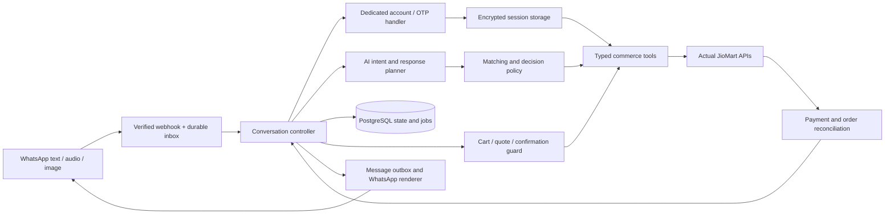

# WhatsApp AI commerce agent: experience and build plan

18 October 2026. **Product plan with partial implementation.** Login/search, typed local shopping-list tools, memory and media input now exist; see [current architecture](agent-architecture.md) and [status](project-status.md) for verified scope. This expands the [technical PRD](technical-prd.md) with the user's latest conversation requirements. The PRD remains the consolidated baseline. [Current API evidence](commerce-api-validation-2026-10-18.md) and [project status](project-status.md) distinguish tested capabilities from work still required.

## 1. Product behavior

The assistant should turn a shopping request into a small number of useful decisions, then a reviewable cart. It should remember relevant context, resolve clear requests without an interview, explain meaningful uncertainty, and let the customer control substitutions and spending.

“Order me Diet Coke” authorizes preparation of that purchase. It does not authorize a different drink or a completed purchase at an undisclosed total. The agent can search, check details and prepare a draft proactively; a final, current cart still needs explicit confirmation.

Core rules:

- Exact product identity comes before popularity, search rank, discounts or personalization. Diet Coke, Coke Zero and regular Coke are different products.
- Usually show one recommendation or a choice between two options. Show more only when the customer asks to browse.
- Resolve what is clear; ask only about a consequential missing choice. Keep the rest of a multi-item list intact.
- Make inferred selections visible and easy to edit. A draft selection is reversible; a purchase is separately confirmed.
- A replacement needs permission. A preference or previous purchase does not silently authorize a different brand, formulation, requested pack or quantity.
- Prices, availability, delivery promises, cart mutations and order status must come from successful commerce operations, not model-generated claims.

## 2. Milestone and remaining dependencies

| Capability | Evidence on 18 October | Implication |
| --- | --- | --- |
| Existing-account OTP, session and refresh | Successful direct API test, without browser automation | Implement a dedicated authentication handler and repeatable session lifecycle |
| Saved delivery addresses | Default address returned | Reuse the selected/default address as a visible candidate; allow change |
| Location-dependent catalog search | Successful real search after supplying the saved pincode | Build the catalog adapter and matching evaluation now |
| Search relevance and completeness | Broad results include unrelated merchandise; advertised cursor repeated page one | Never treat search rank or the first page as exact-product or exhaustive evidence |
| Purchase history | API returned zero; history access remains unresolved | Use explicit preferences and current conversation; no fabricated history |
| Quantity-aware stock, eligible sellers, cart and authoritative quote | Not verified for the real consumer account | Validate before claiming an item is added to a JioMart cart or ready to buy |
| Payment, real checkout, reconciliation and same-account order visibility | Not verified | Gate purchase capability until these pass |
| WhatsApp send, receive and webhook processing | Test assets exist; two-way exchange unverified | Prove the channel at the beginning of implementation |

This is a successful account/address/search milestone. It is not yet end-to-end OMS integration. The observed first-party API route also needs a supported integration/version agreement before a wider pilot; a successful manual probe does not establish a stable third-party contract.

## 3. Customer use cases

“Initial” means the first text shopping experience; purchasing becomes available only after the live cart/checkout gates. “Later” describes sequencing, not a claim that the relevant APIs already work.

| # | Customer request or need | Intended behavior | Sequence/dependency |
| --- | --- | --- | --- |
| 1 | Connect, reconnect or disconnect JioMart | OTP flow, masked identity, expiry recovery; remove local access on disconnect | Initial |
| 2 | Use Home, change address, enter pincode or share location | Make active destination visible; resolve serviceability; recheck affected basket | Initial; new-address writes need validation |
| 3 | Find a specific product | Separate exact matches, unavailable matches, alternatives and irrelevant hits | Initial |
| 4 | “Order me X” | Resolve the item and prepare a draft without dumping search results | Initial; cart writes gated |
| 5 | Choose brand, flavour, formulation or pack | Apply explicit context; ask a compact question when material ambiguity remains | Initial |
| 6 | Set units, multipacks or weight | Distinguish units per pack from pack count; explain rounding or minimum quantities | Initial; weight-based selling only if supported |
| 7 | Handle unavailable items or partial stock | Offer a small number of compatible alternatives or remove the line; obtain consent | Initial after stock validation |
| 8 | Compare value, prices or fit a budget | Compare equivalent units; enforce explicit total/line budget and dietary constraints | Initial bounded comparison; larger basket optimization later |
| 9 | Send a multi-item grocery list | Process clear lines together; surface only unresolved decisions | Initial text |
| 10 | Add, remove, change or undo cart items | Apply the precise edit once; distinguish “make it two” from “add two more” | Initial |
| 11 | “My usual,” a saved list, or reorder | Reuse verified choices; recheck every current SKU, price and stock state | Explicit saved choices initially; history-based reorder gated |
| 12 | See/search previous purchases | Return authorized history with dates, items and status; distinguish unavailable from empty | History access gate |
| 13 | Track an order, delivery or invoice | Resolve which order when necessary; report authoritative state | Order read/track/invoice gates |
| 14 | Choose delivery address, slot or speed | Show supported options and fees; never invent a delivery commitment | Checkout capability gate |
| 15 | Review and place an order | Show full current basket, quantities, destination, charges and total; confirm one version | Real purchase gate |
| 16 | Pay, resume payment or handle failure | Use the issued hosted payment flow; reconcile before another attempt | Payment gate |
| 17 | Cancel, return, replace or check refund | Separate draft cancellation from real order changes; explain unsupported operations | Later, capability-specific gates/support fallback |
| 18 | Send a voice note | Transcribe shopping intent; ask only about uncertain fields | Multimodal milestone |
| 19 | Send a handwritten list/photo | Extract lines; retain confident lines while resolving unclear ones | Multimodal milestone |
| 20 | Use Hindi, English or Hinglish and correct earlier messages | Preserve meaning and units across language changes; follow current correction | Initial text; multimodal evaluation later |
| 21 | Set, inspect, correct or forget preferences | Store explicit useful choices with scope; explain why something was selected | Initial basic preferences |
| 22 | Pause/resume, ask for help, or request updates | Resume a draft with fresh checks; offer support; send optional updates only under channel rules | Initial resume/support; proactive updates later |

The original scope includes spoken replies and an authorized manager voice. Implement these after the transaction path is reliable; calling a text-only milestone the complete source POC would require an explicitly agreed scope reduction.

## 4. Product matching and evidence

### 4.1 Interpret the request

Extract intent, original phrase, category, brand, product line, flavour/formulation, pack size, unit, pack count, budget and explicit constraints. Keep missing values unknown. Preserve the difference between an explicitly requested field and an inferred one.

Context precedence is: **current explicit instruction → relevant current conversation/cart → applicable explicit saved preference → reliable recent purchase evidence → a disclosed reversible default**. Historical guesses never override an explicit request or a hard constraint. Current order-history failures supply no preference evidence.

Proposed quantity default: one sellable unit can be used for an otherwise unambiguous single-item draft, visibly described as “1 × [exact pack].” Never guess between one can and one multipack, infer a large household quantity, or convert “two cans” into two multipacks. Ambiguous unit/pack meanings require a question. The final cart always exposes quantity.

### 4.2 Retrieve, normalize and classify

1. Resolve location context before location-dependent recommendations. If no usable location exists, ask for pincode or a saved address.
2. Search the specific phrase and validated aliases; retain the original constraints. Search results are candidate evidence only.
3. Normalize the raw product/variant/store data into stable typed records. Deduplicate the same sellable SKU while retaining seller/pack differences that matter.
4. Reject category mismatches first: a beverage request cannot select a keychain, merchandise, syrup or energy drink merely because the title resembles it.
5. Compare product family, brand, formulation, size and pack count. Coke Zero is not an alias for Diet Coke. Correct spelling variants only when product identity is established.
6. Enrich a small candidate set through product, variant and availability endpoints when listing fields are insufficient. A title and `sellable: true` do not prove the requested quantity can be fulfilled.
7. Rank only compatible candidates. Use the model for interpretation and nuanced relevance, with deterministic constraint checks before any mutation.
8. If there is no exact result, perform bounded targeted retrieval: validated aliases, relevant brand/category filters and a direct product lookup where an identifier is known. Validate pagination and detect repeated pages before asserting coverage.
9. Stop according to a configured latency/API-call budget. An incomplete or failed search ends in uncertainty, not invented unavailability.

Store independent dimensions: identity match (`exact`, `alternative`, `irrelevant`, `uncertain`), availability (`available`, `partial`, `unavailable`, `unknown`), serviceability and evidence completeness. Attach source IDs, the active location/version and the time checked. Do not collapse everything into an uncalibrated LLM confidence score.

### 4.3 What the assistant says

| Evidence | Permitted statement/action |
| --- | --- |
| Exact identity, requested quantity available, clear context | Prepare that exact line; acknowledge briefly after the relevant action succeeds |
| Two genuine variants, no context to choose | Ask about the one distinguishing choice, such as 300 ml or 350 ml |
| Reliable context resolves an unspecified variant | Prepare the draft and disclose the selection; no redundant question |
| Exact SKU verified unavailable for active delivery context | “Diet Coke 300 ml is unavailable for Home right now.” Offer at most two alternatives |
| Adequate targeted retrieval finds no exact listing, stock unknown | “I couldn't find Diet Coke for this delivery area.” Do not call it out of stock |
| Only broad/top-page results checked or a service failed | “I haven't found an exact match yet.” Continue a bounded lookup or explain the limitation |
| Compatible replacement found | Explain the difference and ask permission; never silently add it as the requested item |
| No compatible alternative within constraints | Say so; offer to omit the line or ask which constraint the customer wants to change |

The current Diet Coke capture establishes none of “Diet Coke globally unavailable,” “Diet Coke out of stock” or exhaustive search coverage. It is a useful negative-matching fixture because its top results include different products and irrelevant merchandise.

### 4.4 Scoped substitution consent

Bind acceptance to the original line, proposed replacement SKU/pack, quantity, price context and cart version. “Yes” to replacing two cans with Coke Zero does not approve Pepsi, a larger pack, another line or future orders. A later price/pack/quantity change invalidates that approval when material. An explicit rule such as “this time any sugar-free cola under ₹50” allows choices only inside that scope and still requires final cart approval.

## 5. WhatsApp conversation design

Use short text plus reply buttons for small decisions; use a list only when requested browsing or a longer set justifies it. Start with one suggestion or two choices, with up to three immediate actions. Do not require a synchronized Meta product catalog for the first POC: text/images and ordinary interactive messages can represent verified JioMart products. Re-evaluate richer commerce templates only if they improve the journey.

Keep one active decision per thread. Button payloads carry opaque references to the question, line and cart version; visible titles contain meaningful product/pack labels. Free text remains valid. A late tap or an ambiguous “yes” cannot act on a newer cart or a different question. “More options” reveals another small group without repeating prior results.

### Example A: an exact product cannot be found

Illustrative UX after a sufficient targeted search; alternatives must pass current availability checks before this wording is used:

> Customer: Order me Diet Coke.
>
> Bot: I couldn't find Diet Coke for Home. I found these alternatives:
> Coke Zero 300 ml — ₹36
> Pepsi Black 300 ml — ₹38
> Would you like one instead?
>
> Actions: Coke Zero · Pepsi Black · Skip
>
> Customer: Coke Zero, two cans.
>
> Bot, after successful cart mutation: Added 2 × Coke Zero 300 ml. Anything else?

The example prices come from the 18 October search, not a guaranteed future quote. If only a local draft has changed, say “On your shopping list” rather than “Added to your JioMart cart.” If an exact Diet Coke SKU is verified out of stock, use that more specific explanation instead.

### Example B: exact product, two sizes

Hypothetical catalog, not a claim about the sizes stocked in the live test:

> Customer: Two Diet Cokes.
>
> Bot: 300 ml or 350 ml cans?
>
> Actions: 300 ml · 350 ml
>
> Customer: 300 ml.
>
> Bot, after success: Added 2 × Diet Coke 300 ml.

If the same request says “the usual 300 ml cans” and that context is reliable, select 300 ml directly. Do not ask the size again. If only one exact suitable pack is available, disclose that pack in the draft; do not silently change an explicitly requested pack.

### Example C: a basket with one uncertainty

> Customer: Milk, six eggs and two Diet Cokes. Keep it under ₹500.
>
> Bot: I've put your saved milk choice and six eggs on the list. For Diet Coke, 300 ml or 350 ml?

This is illustrative and requires a real explicit milk preference and valid product/quantity checks. Preserve the resolved lines while asking about the unresolved line. If several decisions remain, present the highest-impact one first and allow a compact list of unresolved lines on request. A budget includes the final payable total once fees are available; do not promise compliance based only on item subtotal.

### Example D: final review and payment

Show exact product/pack, quantity, line totals, delivery destination, supported delivery promise, discounts, all fees and final payable total. Offer **Confirm order · Edit cart · Cancel draft**. Use **Pay securely** only with a URL issued by the supported checkout flow. A redirect back to WhatsApp is navigation; backend payment/order reconciliation determines success.

“Yes” to a variant or substitute is not checkout confirmation. An interrupted payment resumes or reconciles the existing attempt. If the customer later says “cancel,” clarify whether they mean the draft or an already-created order where context is ambiguous.

## 6. Location, stock and personalization

| Concern | Proposed behavior |
| --- | --- |
| Saved default address | Use as the initial visible context: “Shopping for Home.” Always include destination in final review; do not repeatedly ask for known fields |
| Multiple addresses / no default | Ask a short address choice; use labels/locality, not a full address book dump |
| Pincode-only browsing | Can establish a preliminary search area; actual checkout needs an eligible complete address and possibly coordinates |
| Shared location | Resolve to a delivery address for review; coordinates alone do not specify apartment/access details |
| Address change | Increment location version; invalidate stock/price/delivery evidence and any prior confirmation; revalidate all lines |
| Delivery/store scope | Let JioMart determine eligible sellers/stores. Enforce confirmed T9G8 pilot constraints without inventing a store mapping |
| Availability | Distinguish listing sellability, exact quantity availability and checkout validation; record freshness and recheck at quote/submission |
| Partial stock | Explain requested versus available quantity; do not silently reduce or split across packs/sellers |
| Price/fees change | Requote; show the changed commitment and request confirmation again |
| Customer cart already exists | Verify whether bot and app share a cart. Read before mutation; preserve existing items and detect concurrent edits; never clear blindly |
| Preferences | Store explicit choice, provenance, scope, confirmation time and expiry/review rule; let the customer inspect, correct or forget it |
| History | Use only authorized, verified item-level data. Represent unavailable, partial, stale and genuinely empty as distinct states |
| Privacy | Keep full addresses, phone/OTP and tokens out of model prompts unless a specific non-secret detail is essential; give the model opaque account/address refs and useful display labels |

Remember accepted choices from this bot without claiming they are past JioMart purchases. Ask once before promoting a one-off choice to a durable preference. Repeated observations can become a suggestion (“Remember 300 ml cans?”), not an invisible permanent rule.

## 7. Proposed implementation

Use one backend codebase with an HTTP service, durable worker and PostgreSQL. Python/FastAPI remains the baseline proposal; confirm SDK compatibility before dependency selection. Use a model adapter with typed tool calls, not a framework that can freely execute URLs or purchase instructions. No vector database or runtime swarm of independent agents is necessary for the first POC.



| Module | Responsibility |
| --- | --- |
| WhatsApp transport | Verify ingress, deduplicate message IDs, validate media, send text/buttons/lists and track delivery |
| Account service | Bind WhatsApp sender and business tenant to the verified JioMart account; OTP challenge, refresh, disconnect |
| Conversation controller | Own pending question, shopping context, draft state, approved replacements and allowed next action |
| AI adapter | Parse intent/media, propose candidate classifications and compose concise responses from supplied facts |
| Catalog/matching service | Normalize results, enforce hard constraints, deduplicate, rank, enrich and record retrieval coverage |
| Commerce adapter | Own host/version/session/location rules, permitted endpoints, response validation, retries and capability flags |
| Transaction service | Own cart mutations, authoritative quote, versioned approval, one order attempt and reconciliation |
| Preferences service | Store scoped explicit preferences and verified history features with provenance |
| Operations | Redacted traces, support handoff, customer isolation checks, stuck-payment/order review and purchase kill switch |

The four initially discussed layers remain useful, but orchestration/durable state and transaction reliability need explicit ownership. Personalization is a service of the agent; the model is not the database, inventory authority or payment processor. JioMart checkout feeds its existing OMS; the bot must not create a second independent OMS order.

### Typed tools and control boundary

Proposed internal tools: `begin_login`, `verify_login`, `get_addresses`, `select_delivery_context`, `search_products`, `get_product_details`, `check_sellable_quantity`, `read_cart`, `apply_cart_change`, `quote_cart`, `get_history`, `get_order`, `begin_checkout`, `get_payment_status`, `reconcile_order`, `save_preference`, `forget_preference`.

These names are internal contracts, not claims that all corresponding upstream APIs are verified. Authentication operations belong exclusively to the dedicated handler; the model never receives an OTP or invokes verification with it. Each result carries capability status, source identifiers, timestamps and explicit error/unknown states. The backend injects account/tenant/location references; the model cannot choose another customer's IDs or raw endpoint URLs. Checkout requires a server-created confirmation reference for the current cart/quote, not a model assertion that the customer agreed.

Catalog text, image/OCR content and API descriptions are untrusted product data. They cannot authorize tool calls, change the instruction hierarchy or expose credentials. OTP messages go directly to the authentication handler, bypassing the model and application logs. The manual chat test does not establish that production routing is already implemented.

### Durable records and workflow

Proposed records: account link, conversation, inbound event, pending decision, location version, shopping line, match evidence, preference, draft/cart version, quote, substitution approval, final confirmation, order attempt, payment attempt and outbound message. Raw catalog captures are diagnostic artifacts, not the transactional source of truth.

```text
LINK_ACCOUNT / SELECT_LOCATION
    -> COLLECT_ITEMS <-> RESOLVE_ITEM_DECISION
    -> BUILD_CART -> QUOTE -> AWAIT_FINAL_CONFIRMATION
    -> REVALIDATE -> SUBMIT_ONCE
    -> PAYMENT_PENDING / RECONCILING / ORDER_CONFIRMED
```

An edit returns to the affected stage. Use per-conversation serialization and optimistic cart versions. Tie buttons to pending decisions, reject stale approvals, and preserve progress after restart. Persist a submission attempt before the network call. A timeout is an unknown outcome until reconciled; never blindly retry order creation. Message delivery retries must not replay commerce mutations.

## 8. WhatsApp operating requirements

Start with ordinary text and small interactive choices; include text fallback. Validate the chosen Cloud API version and payload limits during channel setup rather than implementing against an archived SDK. The product choice to show at most a few options also fits the channel's interaction style. [Meta's reply-button example](https://www.postman.com/meta/whatsapp-business-platform/request/x0kd1at/send-reply-button).

Track the customer-service window. Outside the 24-hour window, use approved templates where appropriate; keep proactive messages opt-in, support opt-out and provide a clear human/support escalation route. Do not turn a saved shopping list into an unsolicited reminder campaign. These constraints come from the [WhatsApp Business Messaging Policy](https://business.whatsapp.com/policy), reviewed 18 October 2026. Business identity and support details must be accurate; the bot should be a scoped commerce assistant.

## 9. Build sequence and gates

| Stage | Deliverable | Exit evidence |
| --- | --- | --- |
| 0. Repeatable contracts and channel | Formalize tested login/address/search calls; validate session expiry, redirects/location, pagination, errors and two-account isolation; prove a WhatsApp send/reply | Redacted contract tests plus a real inbound event and delivered response; no dummy store |
| 1. Text shopping agent | Intent extraction, active location, exact/alternative filtering, scoped preferences, compact questions and durable draft edits | Diet Coke/keychain/variant cases pass; no purchase enabled; draft wording truthful |
| 2. Real cart and quote | Verify variants, quantity-aware availability, seller eligibility, shared-cart behavior, mutations, complete pricing and final confirmation | Verified real customer cart and authoritative quote; address/stock changes invalidate approval |
| 3. Real purchase | Supported hosted payment and order sequence, idempotency/reconciliation, same-account visibility | One explicitly confirmed real purchase through WhatsApp; reliable lookup after timeout/retry |
| 4. Multimodal and personalization | Voice notes, handwritten lists, language correction, scoped memories; integrate history when resolved | Representative media cases pass; history-based behavior uses actual evidence, with unavailable-history fallback |
| 5. Source voice experience and pilot | Authorized manager voice, switch/disable controls, support runbook and monitored controlled testers | Full source scope demonstrated or a documented owner-approved reduction; operational acceptance |

Track history access and the supported JioMart integration agreement alongside stages 0–2. History is not required to build an honest text shopping draft; it is required before claiming purchase-history personalization. Order reconciliation/visibility is a gate for stage 3 regardless of whether historical-order personalization is ready. Post-order cancellation/returns and proactive reminders are separate later capabilities.

Do not assign fixed delivery dates before channel, cart and checkout dependencies are tested. Implementation starts with stage 0 and stage 1 only after the user proceeds beyond this planning request.

## 10. Acceptance scenarios

| Scenario | Required outcome |
| --- | --- |
| Diet Coke query returns Coke Zero, regular Coke and keychain | Reject merchandise and mismatched exact identities; replacements labelled; no silent substitute |
| Exact item absent from top results / repeated cursor | Detect incomplete coverage; no false out-of-stock or global-absence statement |
| One exact available SKU, all meaningful fields resolved | Prepare one line without redundant clarification; final cart still confirmed |
| Two valid sizes without preference | One short size question |
| Current size differs from a saved preference | Current instruction wins |
| History returns zero but completeness/mapping is unresolved | No “you never ordered” or fabricated “usual”; use history-unavailable state |
| “Two cans” versus an eight-pack | Preserve intended unit count; ask instead of multiplying into two eight-packs |
| A substitute is accepted | Apply only to that line, replacement and request; no future blanket consent |
| Multi-item list has one ambiguous line | Preserve clear lines; ask only about unresolved choice |
| Stock is partial, unknown or stale | Disclose accurately; never promise the requested quantity based on listing flag alone |
| Address changes after selection/approval | Refresh all location-dependent evidence and invalidate approval |
| Budget met before fees but exceeded after quote | Explain final total and ask to adjust; do not submit |
| Existing app cart changed concurrently | Detect/reconcile version changes; no lost updates or blind clearing |
| Old button or duplicate inbound webhook arrives | Reject stale decision or deduplicate; one intended mutation |
| Checkout times out after upstream success | Reconcile original attempt; no duplicate purchase |
| Payment redirect returns before confirmation | Report pending; backend verifies payment independently |
| Session expires mid-cart | Reconnect and preserve draft; refresh quote before confirmation |
| Two customers ask for similar products | Keep sessions, addresses, history and carts isolated |
| Product text contains tool instructions | Treat as untrusted data; no arbitrary API or credential access |
| Voice/photo has one unreadable field | Ask for that field; keep the rest of the list |

Release gates: zero silent substitutions, wrong-account actions, false order-success claims or duplicate orders in the agreed critical scenario set. Measure exact-match precision, irrelevant-hit rejection, incorrect availability assertions, unnecessary clarification rate, correction rate, successful cart completion, latency and cost per completed cart. Start with roughly 50 labelled text scenarios plus failure/transaction cases; add representative voice/photo examples at stage 4. This is an evaluation proposal, not a measured quality score.

Reuse product-only captures for matching tests; keep credentials and customer history out of fixtures. Contract tests against real services should be bounded. Test failure/retry logic with isolated fixtures without presenting those tests as completed real commerce.

## 11. Working decisions and review points

Proceed in the plan with: a single controlled agent workflow, small WhatsApp choices, explicit substitute consent, a visible one-unit draft default only when unambiguous, default-address context with final review, and history-independent fallbacks. Select a model/provider, hosting and exact dependency versions during implementation using the labelled evaluation set and available credentials; no provider choice or spending commitment is made here.

Remaining integration questions are concrete: stable API/SDK/version and permitted deployment contract; correct search pagination; exact SKU/quantity stock and eligible-store behavior; real cart/payment/checkout/idempotency; same-account order visibility/history; T9G8 mapping; and actual two-way WhatsApp setup. These do not require another product questionnaire before documenting or starting the independent work above.
